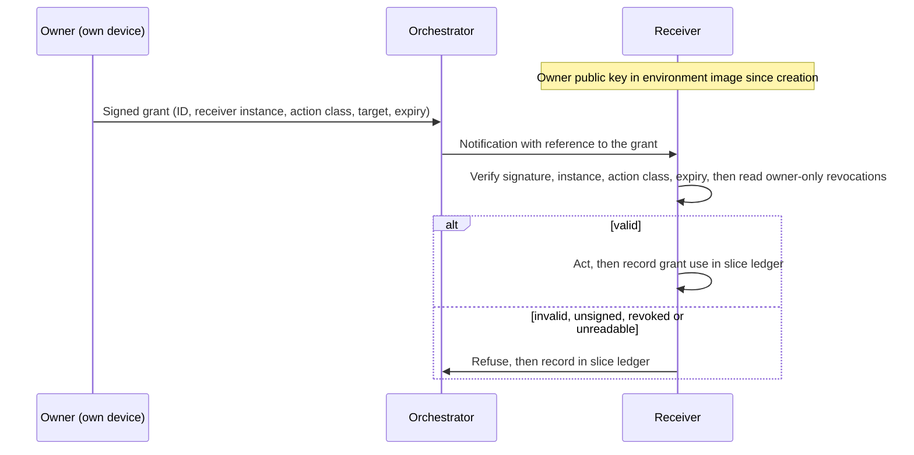

# Governed semi-autonomous development: Control reference

*This document is for security and platform teams who implement the method's controls: what each control prevents, what it costs, which profile requires it and what proves it. The method itself, including the profiles and the glossary, is in [method.md](method.md); one concrete tool mapping is in [claude-code-reference.md](claude-code-reference.md).*

---

## How to read this reference

Each layer section gives a control table, then the rules that need more than a table row. Columns:

- **Prevents**: the failure the control exists to stop.
- **Serves**: S (secure), C (correct), E (efficient).
- **Cost**: what the control costs to run.
- **Profile**: the lowest profile that requires it. A control required at Lite also applies at Standard and High. A control required at Standard also applies at High.

Each layer ends with the artefact that proves the control is in place. The layer objectives and the profile table are in [method.md](method.md) (§5, §12). The control-to-profile map at the end of this document is the per-control form of that table. Terms are defined in the method's glossary.

## L1 Infrastructure isolation

| Control | Prevents | Serves | Cost | Profile |
|---|---|---|---|---|
| Isolated environment | A command that deletes, fills or rewrites more than intended, hitting the owner's workstation | S | Setup; slower first start | Lite: one shared. Standard: per session. High: VM per session |
| No host or production credentials mounted or forwarded (SSH agent, git credential helpers, cloud CLI sessions) | Agents, or content they read, reaching production or personal accounts | S | Owner performs credentialed steps | Lite |
| Destructive and adversarial tests only against stubbed copies or throwaway stores | One test taking down the environment that every session shares | S, C | Stubs and seed scripts | Lite |
| Egress allow-list | Exfiltration; fetching unreviewed code | S | List upkeep; blocked legitimate fetches | Standard |
| Throwaway data stores per session | Destructive tests corrupting long-lived data | S, C | Seed and teardown scripts | Standard |
| Lab separate from production | A test deployment mistaken for, or wired into, production | S | Extra environments | Standard |
| Per-session, least-scope credentials | A leaked credential with wide reach or no revocation path | S | Issuing and revoking per session | Standard |
| Segmented network; ephemeral environments | Lateral movement; drift in long-lived environments | S | Provisioning automation | High |

Agents run commands faster than anyone can review them line by line. A guard test aimed at the filesystem root, or a cleanup aimed at the wrong target, is an ordinary mistake. Isolation turns it into a lost environment, not a lost workstation. Guards are tested against stubbed copies of the commands they guard. Every change to a lab environment made outside the normal deploy path is preceded by a backup and logged with its exact revert command.

### Credential scope

Some credentials cannot be denied, because the session needs them: the model API key, push credentials for the internal remote, lab credentials and broker credentials. At Standard, each is per session and least-scope:

- a model key with a spend cap;
- push credentials limited to the internal remote;
- lab credentials per slot.

All are revoked at teardown. Each one is treated as readable by anything the session runs.

*Proof: the environment definition in the repository; the kickoff record showing a credentialed action refused.*

## L2 Session isolation

| Control | Prevents | Serves | Cost | Profile |
|---|---|---|---|---|
| One session per worktree or clone, one branch per session | Two agents in one checkout; edits on the wrong branch | S, C | Disk; one install per environment | Lite: worktree. Standard: clone per environment |
| Unique project names and ports per session; shared-resource registry | One session's stack replacing another's through a reused project name, port or container; silent collisions on lab slots and branch names | C, E | One committed file kept current | Lite, where more than one session runs services |
| Own runtime | Shared processes and caches between sessions | C | One runtime per environment | Standard |
| Own identity | Unattributable actions; borrowed credentials | S | Identity provisioning | Standard. High: separate OS identity and credentials |
| Internal git remote as the only shared repository surface | Shared writable `.git` across environments | S, C | Running the remote | Standard |
| Per-ref push enforcement | One session altering another's branch | S | Ref permissions on the remote | High |

### Shared repository across environments

From Standard, each environment holds its own clone. An internal git remote is the only shared surface:

- Workers push only their own branches. At High this is enforced per ref.
- The orchestrator fetches and integrates.
- Inspection of uncommitted work uses a read-only mount.

Environments never share a writable checkout or `.git` directory. Shared refs, stash and hooks would let one session alter or execute code in another. Concurrent operations on a shared object store can also see each other's partial state and report false errors. Pushing to the internal remote is a separate permission from pushing to the public host.

### Worktrees at Lite

At Lite, worktrees in one isolated environment are enough. They separate files and branches. They do not separate `.git`, the stash, hooks or local tool approvals.

- **Shared `.git`, stash and hooks are accepted**, because the shared environment is itself isolated from the host. The consequence is that compromise of one session is compromise of all of them. This is a recorded Lite residual ([method.md](method.md), §12).
- **Shared approvals are not accepted.** Lite forbids standing ("don't ask again") approvals in every session. Permission rules live only in settings files that the owner applies.

*Proof: the registry; the remote's ref permissions; the environment list in the ledger.*

## L3 Tool control

| Control | Prevents | Serves | Cost | Profile |
|---|---|---|---|---|
| Deny push, publish, secret reads | Outward actions by agents; credentials in context | S | Owner performs those actions | Lite |
| Enforcement material read-only to the session | A session widening its own limits | S | File ownership and placement at setup | Lite |
| Enforcing checks fail closed | A crashed or timed-out check letting actions through | S | Error handling in every check | Lite |
| Agent tooling only from an owner-approved list | Unreviewed plugins, tool servers or scripts running in every session | S | List upkeep | Lite. Standard: pinned versions, auto-update off, changes through the protected-path review |
| Pre-execution hooks for environment rules | Known rules broken under load | S, C | Writing and testing hooks | Standard |
| Wrapped commands | Risky tools run with unsafe defaults or targets | S, C | Wrapper upkeep | Standard |
| Allow-list only | Any tool use not foreseen for the role | S | Frequent list updates | High |
| Action classifier on side-effecting calls | A permitted tool used outside the task: destructive, exfiltrating or access-acquiring calls the rules allow; actions driven by instructions in fetched content | S | A self-hosted decision engine shared with L6; latency on side-effecting calls; local calibration | High |

### Enforcement material

A session cannot write what enforces its limits:

- permission settings;
- hooks and hook scripts;
- the trust anchor;
- the grant manifest;
- the revocation records.

These are read-only to the session, or held outside its environment. The kickoff tests try to modify each one and record the refusal ([method.md](method.md), §4).

### Fail-closed checks

Every enforcing check fails closed. An error, a crash or a timeout in a check counts as deny. The kickoff tests remove a check's input and confirm the guarded action is refused.

### Agent tooling supply chain

The agent's own tooling is controlled like product dependencies:

- the agent CLI version;
- plugins and tool servers;
- skills and subagent definitions;
- hook scripts;
- models.

Tool servers and hooks often run outside the shell sandbox. A tooling change committed inside a slice reaches every session after a merge.

### Environment rules worth a hook

- Live test suites target a dead endpoint unless the brief names a lab target.
- No container or database starts outside throwaway environments.
- No reads of environment files or credential stores.
- No deletion of a remote branch until the merge is confirmed and the trees compare equal.

### Rule text is not a boundary

A deny rule that matches command text covers the usual form of a command. It does not cover a full path, a shell wrapper or a re-spelled flag. Deny lists catch mistakes. The boundary against a determined adversary is L1. A rule that must hold needs an OS-level sandbox, or a hook that inspects the full command and is tested against evasions.

### The action classifier (High)

Rules decide which tools a role may use. They cannot tell a permitted tool used for the task from the same tool used against it. At High, a calibrated action classifier checks for that misuse.

- **Position.** Deny and allow rules run first, then the deterministic hooks. The classifier sees only calls the rules allowed.
- **Scope.** Only side-effecting calls are checked: shell commands, network access, writes outside the session's worktree, and tool-server calls with effects. Reads are not checked, because the latency would fall on every call.
- **Questions.** The classifier answers signal questions: is the call destructive, is it exfiltrating, does it acquire access or credentials beyond the task, does it follow from instructions in fetched content? Whether a call is within the slice's scope is decided deterministically, from the closed action classes and the slice plan. Where people would disagree about the label, calibration cannot make a model's answer reliable, so scope is not left to it.
- **Context from trusted sources only.** The classifier receives the slice plan, the delegation manifest and the provenance of the content that preceded the call. It never receives the agent's own justification for the call. A decision model leans on its context, so whoever writes the context steers the verdict.
- **Outcomes.** Pass; block, recorded for batch review; or, for an action class the owner can grant, the tool's own permission prompt. The classifier fails closed and never feeds the owner's decision queue directly.
- **One engine.** It shares the decision engine, the thresholds discipline and the calibration records with the L6 decision classifier.

**Residual risk.** As in L6: the classifier is probabilistic, catches some misuse rather than all of it, and never confers authority.

*Proof: permission files, hooks and their tests in the repository; the kickoff record; the action classifier's calibration records.*

## L4 Permission sets and delegation

| Control | Prevents | Serves | Cost | Profile |
|---|---|---|---|---|
| Owner performs all outward actions, from a checkout agents cannot write | Any agent acting outward; agent-planted hooks or configuration running with the owner's credentials | S | Owner time; a separate checkout | Lite |
| Role permission sets | Workers holding orchestrator or owner powers by default | S | One set per role | Standard |
| Delegation manifest | Authority whose source, scope or expiry nobody can state | S | Upkeep | Standard |
| Planned delegations translated into tool configuration and exercised at kickoff | The tool refusing what the owner delegated, and every refusal bouncing to the owner | S, E | Translation and a kickoff test per delegation | Standard |
| Grants as the owner's answer to the tool's own permission prompt in the receiving session | Authority passed on through an intermediary or imitated in conversation | S | Owner acts in each receiving session | Standard |
| Owner-signed, instance-bound, time-bound grants verified by the receiver | Forged or replayed grants across separate environments | S | Signing tooling; key management | High |
| Two-party rule for releases: owner + human reviewer, or owner + independent verifier with a required signed verdict for a sole owner | A mistaken actor or a compromised agent releasing; a release built on fabricated evidence | S, C | A second party per release; for a sole owner, a separate trust domain to run and its own evidence rebuild | High |

### Where the owner acts

The owner performs outward actions from a checkout that agents cannot write, after fetching the reviewed ref into it. The owner never acts inside an agent environment. An agent can plant git hooks, git configuration or package scripts in its own checkout, and these would run with the owner's credentials. At Lite on a dedicated machine, agents run as the owner's user. That residual is recorded ([method.md](method.md), §12).

### Permission sets must express the delegation

Enforcement reads configuration, not conversation. At kickoff, every planned delegation is translated into the tool's own configuration. Examples:

- the orchestrator tagging a release;
- writing a gate value;
- writing to a lab environment.

The translation covers the permission rules and, where the tool has one, the allowances of its safety classifier or automatic approval mode. Without it, the tool refuses what the owner delegated. Kickoff exercises each planned delegation once.

Delegations not planned at kickoff go back to the owner, who either performs the action or issues a grant. An agent never works around a refusal. A repeated refusal of the same delegated class is handled as an incident ([method.md](method.md), §11).

### Baseline and grants

Authority is valid only where the owner gives it. The two levels are summarised in [method.md](method.md) (§5, L4). The detail:

- **Baseline.** At kickoff the owner establishes, in each environment:
  - who its orchestrator is (pinned identity);
  - what the orchestrator may assign (in-scope slices, plan approvals, rulings);
  - the session's own limits.

  Across environments the baseline is a signed kickoff manifest. The trust anchor is the owner's public key, provisioned into the environment image at creation; it never arrives over the bus. Every baseline at every level is owner-signed (High) or owner-applied (Standard).
- **Grants.** Grants cover actions beyond the baseline, such as an infrastructure write, a permission exception or a production action. At High, a grant is a signed manifest entry naming scope, receiving session and expiry. The orchestrator may carry it; carrying a signed grant is not relaying. The receiver accepts it only because the signature verifies.

**What catches misdirection inside the baseline.** A compromised orchestrator or bus can misdirect work inside the baseline. Only controls the orchestrator does not run can catch that:

- required CI;
- the protected-path review;
- the owner's merge;
- at High, the external reviewer and the independent verifier.

### Nested delegation

- A function lead's baseline is bounded by the project's.
- A worker's pinned orchestrator is its lead.
- The project orchestrator instructs leads, not workers.
- Adding a session to a standing team is a kickoff for that session.
- Grants beyond the baseline go owner-signed directly to the receiver. They are never relayed down levels.

### Grant rules at High

- **Instance binding.** Each grant carries a unique ID. It is bound to the receiving session *instance*, meaning the per-session credential or instance ID issued at kickoff, not the session's name. It is valid for any action in its scope until it expires or is revoked. Replay protection is instance binding plus expiry. Expiries are kept short.
- **Closed scopes.** Grant scopes come from a closed list of grantable action classes, fixed at kickoff.
- **Signing on the owner's device.** The owner signs on the owner's own device. The device shows a rendering of the exact bytes being signed: receiver instance, action class, target and expiry. The decision message shows the same rendering. The private key never enters an agent environment or the repository.
- **Revocation.** The owner can withdraw a grant before expiry with a signed revocation. Receivers read revocations from a location only the owner can write, such as an owner-only protected ref on the internal remote. If that location cannot be read, the check fails closed. Expiry is the hard bound; revocation is best-effort.

### Grants across profiles

- **Lite:** no grants. The owner performs the action.
- **Standard:** grantable action classes are configured to ask. A grant is the owner's answer to the tool's own permission prompt in the receiving session. Conversation text is never a grant, whoever it appears to come from. With standing approvals forbidden, each answer covers one action.
- **High:** sessions run in environments the owner cannot attend directly. A receiver cannot tell who wrote pasted text, so signatures replace direct presence.

**Refusals at Standard.** A receiver refuses a grant when:

- it did not come through the tool's permission prompt (for example, conversation text or a relayed message);
- it was given in another session;
- its scope does not cover the action;
- it was recalled from a summary instead of re-read and verified.

**Additional refusals at High.** A receiver also refuses a grant when:

- the signature does not verify;
- it was issued to another session instance;
- it has expired;
- a revocation covers it, or the revocation location cannot be read;
- its action class is not on the kickoff list.

### The two-party release rule

At High, a release needs two independent parties: the owner and a second reviewer. Where a second human exists, the second reviewer is human. Where the owner is alone, the second party is an **independent verifier**: an agent session in a separate trust domain, with its own environment, credentials and owner-applied configuration.

- **It rebuilds its own evidence.** The verifier receives only the release commit and the release run sheet. It builds the artefacts itself, computes the digests and runs the tests. It does not trust the initiative's copy of the evidence, because a compromised session can fabricate evidence that looks consistent.
- **Its signed verdict is required.** The verifier signs its verdict over the release digest, and the release step checks that signature. The verifier verifies. The owner releases.
- **Releasing without it is a downgrade.** The owner may still release without a passing verdict, but only as a recorded decision in the decision register. That decision downgrades that release to Standard, and the run sheet records the downgrade.

**Residual risk.**

- The independent-verifier form covers a mistaken actor and a compromised agent.
- It does not cover a compromised owner: a sole owner who is compromised can still release by taking the recorded downgrade.
- A verifier on the same model family shares that model's blind spots. A different model or provider for the verifier, where possible, reduces this.

*Proof: the delegation manifest, the permission sets, the kickoff record, the grant entries in the slice ledgers, and the verifier's signed verdicts.*

## L5 Repository controls

| Control | Prevents | Serves | Cost | Profile |
|---|---|---|---|---|
| No commits on main; PRs | Unreviewed changes on the release line | S, C | PR overhead | Lite |
| Owner-only merge and tag | Agents creating outward history | S | Owner time | Lite |
| Boundary scans, including the ledger ref | Private paths, names or identifiers leaking into a public repository | S | Scan upkeep; false positives | Lite, where a public mirror exists |
| Fresh integration branch per vehicle, owned by the orchestrator | Slices merged without integrated testing; force pushes to reset a used branch | C | Branch upkeep | Standard |
| Required CI, enforced by the host | Merges that rest on an agent's report or pass only locally; a ritual or agent skipping a check | S, C | CI time and cost | Lite: minimum set. Standard: full suite |
| CI kept out of band | Agents influencing, skipping or forging their own verification; secrets exposed to unreviewed code | S | Runners separate from agent environments; workflow discipline | Lite |
| Protected-path review | Changes to the enforcement and release machinery travelling the same path as feature code | S | Owner reads those diffs; one fixed security pass | Standard |
| Signed commits and tags | Forged or unattributable history | S | Key management | High |
| Reproducible builds | Artefacts that cannot be tied to source | S, C | Build hermeticity | High |

### Integration branches

After a vehicle merges, the next vehicle's integration branch is cut fresh from main, and workers rebase onto it. No force push, backup branch or reset is needed. The post-merge ritual prunes old branches after confirmation.

### Out-of-band verification

CI is the method's out-of-band verifier. It runs outside every agent environment, on infrastructure agents cannot write, with credentials agents do not hold, against the exact commit that will merge. Its result is deterministic and recorded by the repository host. Every other check before a merge runs inside an agent environment and reaches the owner as an agent's report, rituals included. CI is the one result the agents cannot produce for themselves.

Four rules keep it out of band:

- **The host enforces the gate.** Branch protection requires the checks before a merge, so neither an agent nor a ritual can skip them. Bypassing them is an owner decision, recorded in the decision register.
- **Agents cannot change what verifies them.** Changes to CI workflows reach the owner as the diff at every profile; this is the one protected path Lite already requires. Workflows triggered by agent changes get no secrets and no write tokens. Only workflows running reviewed code from main hold release credentials.
- **Runners are separate from agent environments.** A self-hosted runner never shares a host, a network segment or credentials with an agent environment.
- **Results are read from the host, by commit.** A merge or release decision cites the host's conclusion for the exact commit. An agent's "CI is green" is a claim. "Pending" is not green.

The minimum set at every profile is the build, the test suites, type and lint checks, and a secret scan. Standard runs the full suite, including slow and database suites, and the boundary scan where a public mirror exists. At High, CI is the deterministic half of release verification, and the second reviewer or independent verifier is the judgement half. Neither replaces the other.

CI time is a real cost. The economy rules ([method.md](method.md), §10) keep it proportionate: local gates first, one CI run per vehicle, and a branch goes to CI only when it is ready to pass.

### Protected paths

Changes to these paths reach the owner as the diff itself. This is the one exception to "decisions, not files":

- permission sets;
- hooks and hook scripts;
- CI workflows;
- the release kit and gate definitions;
- environment definitions;
- trust anchors;
- agent instruction files: project and agent instructions that steer every future session.

A security pass reviews each such change. Its brief is a fixed ritual that the orchestrator does not author. At Standard this can be a code-owners rule on the repository host.

*Proof: branch protection with required checks, the host's check conclusions per merged commit, CI configuration, runner placement, code-owner rules, scan configuration, signed tags.*

## L6 Message controls

| Control | Prevents | Serves | Cost | Profile |
|---|---|---|---|---|
| Authority never relayed | Escalation through a trusted intermediary | S | Owner acts in the receiving session | Lite |
| Local messaging with tool-attributed senders | Spoofed senders on one machine | S | None | Lite |
| Content as repository references | Unreviewable or injected payloads; context bloat | S, C | Commit before notifying | Standard |
| Authenticated messaging, with an authenticated cross-environment channel where sessions run in separate environments; message audit written by the transport | Untraceable instructions; ad-hoc channels without sender identity | S, C | Running the channel; audit storage | Standard |
| Private bus with the full requirements below | Spoofing, eavesdropping and misrouting across environments | S | Running a broker | High |
| Filtering and provenance on untrusted content | Instructions hidden in fetched pages, issues, logs or package metadata | S | Filter upkeep | High |
| Decision classifier at the gateway and content ingestion | Injected instructions that pass the deterministic checks and reach a reading agent | S | Self-hosted model; local calibration; added latency at the filtered points | High |

### References, not payloads

A slice plan, finding or decision request lives in a committed file, and the message only says where. This leaves a reviewable record and limits what a forged message can carry.

### The message bus

Once sessions run in separate environments, local session messaging no longer reaches across them.

- **Standard.** Sessions in separate environments communicate over an authenticated channel. It has per-session credentials, sender identity stamped by the transport, and references instead of payloads.
- **High.** The channel is a private bus. The reference choice is a self-hosted broker with per-identity credentials and per-subject permissions (for example NATS), fronted by a small mailbox tool the agents call. Requirements:
  - reachable only on the private network, with no published interface;
  - mutual TLS and per-session credentials, issued at kickoff and revoked at teardown;
  - role ACLs: a worker reaches only its orchestrator; peers only through an allow-listed gateway;
  - sender identity stamped by the broker, never by the sender;
  - size and schema limits;
  - references instead of payloads;
  - filtering on externally sourced content;
  - a message audit written by the broker, holding metadata and hashes, not bodies.

Each session's inbound message policy is set at kickoff, so that expected messages arrive without the owner's help and unexpected ones are held.

### The decision classifier (High)

At High, a decision classifier adds one more filtering layer on top of the message controls above. It never replaces them, and it is never the boundary.

- **Order.** Deterministic checks run first: sender ACL, schema, size and the references-only rule. The classifier sees only what passes them.
- **Placement.** The classifier runs at named ingestion points: the federation gateway (peer messages), fetch tools and capability inputs.
  - Content read through ordinary tools, such as dependency source or tool output, is not covered. It rests on L1 and L3.
  - The classifier does not run on internal notifications. Those carry repository references and are low risk. Filtering them adds latency, and false positives would stall work.
- **Decisions.** The classifier returns a calibrated confidence. Two thresholds map it to one of three outcomes: pass, quarantine for review, or block. It fails closed: an error or a missing verdict counts as block. Every decision goes to the ledger with its confidence.
- **Thresholds from a target error rate.** The owner sets the error rate tolerated on items the classifier decides alone. The thresholds are fitted so that rate holds, and everything between them goes to review. The calibration record states the **coverage** at that target: the share decided without a reviewer. Coverage sizes the review load, and it shows what a stricter target costs.
- **Two decider tiers.** A single-pass encoder model serves the high-volume points: content ingestion and the L3 action classifier. A slower, calibrated reasoning model serves the low-volume, higher-stakes points: the federation gateway, and first-pass triage of the quarantine queue before a reviewer sees it.
- **Quarantine.** Quarantined items are reviewed in batches by an output-only reviewer. They never go into the owner's decision queue. A per-source quarantine ceiling stops a source that produces too many.
- **Local calibration.** Thresholds and temperature are fitted on the deployment's own labelled set, or the model is fine-tuned on it with a calibrated-decision training recipe.
  - The set includes an injection corpus and real benign traffic.
  - It is versioned, and its labels come from humans or deterministic sources.
  - The false-positive and false-negative rates and the coverage are recorded and re-evaluated on every model or threshold change.
  - The confidence a shipped model reports is not trusted as calibrated.
- **Inside the trust boundary.** The model is self-hosted or open-weight and runs without egress. Its weights are pinned by hash and verified before load.

**Residual risk.** A classifier is probabilistic. It catches some of what reaches the reading agent despite the other controls, not all of it. It never confers authority. Authority still comes only from the owner's signature.

*Proof: channel and broker configuration, ACLs, credential records, message audit, classifier calibration records.*

## L7 Process controls

| Control | Prevents | Serves | Cost | Profile |
|---|---|---|---|---|
| Plan and design review | Designs that are expensive to unbuild | S, C | A review round before work | Lite; Standard adds the security lens |
| Deliverable review on the final diff | Defects across slices; plan and code diverging | S, C | One review per vehicle | Lite |
| Pre-PR gate (ritual) | A PR opened without the checks its profile requires | S, C | One ritual run per vehicle | Lite: covering tests, final-diff review, leftover scan. Standard: + security review, acceptance-criteria trace. Any profile: + boundary scan where a public mirror exists |
| Leftover sweep | Debug code, stale flags, temporary bypasses, private references and working-document references left behind | S, C | One sweep per checkpoint | Lite: as a scan in the pre-PR gate. Standard: full sweep per checkpoint |
| Checkpoint review | Integration defects no single slice shows | C | One review per long build stretch | Standard |
| Acceptance-criteria trace | Criteria nobody checks until users notice | C | Trace upkeep | Standard, in the vehicle's pre-PR gate |
| Multi-lens review | Defects outside one reviewer's habits | S, C | More specialist runs | High |
| Rehearsed, reproduce-gated release kit | Releases failing half-way; artefacts differing from rehearsal | S, C | Kit engineering; rehearsal time | High |
| External reviewer | Blind spots shared inside the initiative | S, C | Peer time | High |

### The release kit

The kit runs in ordered phases:

1. **Dry run:** derive values and check preconditions.
2. **Rehearsal:** build artefacts and record digests.
3. **The no-return step.**
4. **Readback** against the rehearsal.
5. **Per-target steps.**

Each phase has a gate that the owner or a named reviewer sets. Four rules apply to every kit:

- Setting a gate and reading the log that justifies it are separate actions.
- Every phase takes a run lock, so runs cannot overlap.
- Rollback anchors are recorded before each phase.
- The kit is pinned for the whole freeze.

At least one digest comes from an independent build, because a check that compares an output with itself proves nothing. Pre-release checks run before the tag. If the owner releases despite a failed check, the decision register records why. If an emergency vehicle preempts the freeze, the kit re-rehearses from phase 1.

### Gates must be able to fail

Each new gate is tested once with an input it must reject. A gate that passes any input produces false evidence.

### Rituals

Process controls are enforced through rituals. The core set:

- **Pre-PR gate.** The checks its profile requires (table above). For a vehicle, it also carries the checkpoint duties.
- **Post-merge ritual.** Sync, prune branches after confirmation, cut the next integration branch, and surface follow-ups such as a public-mirror push.
- **Public-mirror push.** Pre-flight scans, the push, and the mirror-side PR.
- **Maintenance sweep.** The sustain-mode loop, including finalisation.

A ritual encodes the whole gate for its profile, not part of it. A ritual that runs three of five required checks makes the missing two invisible, because everyone trusts the ritual.

*Serves S, C, E. Cost: writing and maintaining each ritual. Profile: the pre-PR gate and post-merge ritual at Lite; the others where they apply.*

*Proof: review records, sweep results, the acceptance trace, the run sheet with its gate log, ritual output for each vehicle.*

## L8 State and audit

| Control | Prevents | Serves | Cost | Profile |
|---|---|---|---|---|
| Ledger on its own ref in the repository | Lost state; limits widened by a lossy summary; ledger history discarded by product merges | C, E | One commit per event | Lite |
| Decision register | Decisions re-opened or contradicted | C, E | Recording | Lite |
| Claims only from output | "Passes" or "fixed" without evidence | C | Discipline backed by review | Lite |
| Minimal metrics: escaped defects, owner interrupts, rule breaches | Steering by impression; a stalled learning loop | E, C | Counting from the ledger | Lite |
| Message audit, written by the transport | Untraceable instructions; a participant omitting its own messages | S, C | Storage | Standard |
| Tamper-evident audit trail, with the chain head anchored outside the writer's reach | Undetected edits to history, including by the ledger's own writer | S | Hash-chaining plus an external anchor | High |
| Full metric set | Steering by impression | E | Collection | High |

### Ledger hygiene

The ledger and the message audit record metadata, hashes and references, not bodies.

- Observed output is excerpted, and it passes the secret scan before commit.
- Quarantined or blocked content is stored outside every agent's read path.
- The ledger ref is covered by the public-boundary scan.

### Corrections

A wrong claim is corrected in the log as soon as it is known. The correction goes to whoever received the claim.

### Tamper evidence

A hash chain computed by the ledger's writer can be recomputed by that writer. The chain head is therefore anchored outside the writer's reach: in the broker's log, or as a head the owner records at each checkpoint.

*Proof: the ledger, the register and the audit store.*

## Control-to-profile map

This map lists every control in this reference at the lowest profile that requires it. It is consistent with the profile table in [method.md](method.md) (§12).

| Layer | Lite | Standard | High |
|---|---|---|---|
| L1 | One shared isolated environment; no host or production credentials mounted or forwarded; destructive and adversarial tests only against stubs or throwaway stores | Isolated environment per session; egress allow-list; throwaway data stores per session; lab separate from production; per-session least-scope credentials | VM per session; segmented network; ephemeral environments |
| L2 | Worktree per session; unique project names and ports plus resource registry where more than one session runs services; no standing approvals | Clone per environment; internal git remote as the only shared surface; own runtime; own identity | Per-ref push enforcement; separate OS identity and credentials |
| L3 | Deny push, publish and secret reads; enforcement material read-only to the session; enforcing checks fail closed; agent tooling from an owner-approved list | Hooks for environment rules; wrapped commands; pinned agent tooling with auto-update off and changes through protected-path review | Allow-list only; action classifier on side-effecting calls |
| L4 | Owner performs all outward actions from a checkout agents cannot write | Role permission sets; delegation manifest; planned delegations in tool configuration, exercised at kickoff; grants as the owner's answer to the tool's permission prompt | Owner-signed, instance-bound, time-bound grants with closed scopes, on-device signing and owner-only revocation; two-party release rule with the independent verifier for a sole owner |
| L5 | No commits on main; PRs; owner-only merge and tag; required CI (minimum set) enforced by the host and kept out of band; boundary scans (including the ledger ref) where a public mirror exists | Fresh orchestrator-owned integration branch per vehicle; full CI suite; protected-path review | Signed commits and tags; reproducible builds |
| L6 | Authority never relayed; local messaging with tool-attributed senders | Content as repository references; authenticated messaging, including a cross-environment channel where needed; message audit written by the transport | Private bus with full requirements; filtering and provenance on untrusted content; decision classifier at the gateway and content ingestion |
| L7 | Plan and design review; deliverable review on the final diff; pre-PR gate (covering tests, final-diff review, leftover scan); pre-PR and post-merge rituals | Security lens; security review and acceptance-criteria trace in the pre-PR gate; leftover sweep per checkpoint; checkpoint review | Multi-lens review; rehearsed, reproduce-gated release kit; external reviewer |
| L8 | Ledger on its own ref; decision register; claims only from output; minimal metrics | Message audit written by the transport | Tamper-evident audit trail anchored outside the writer; full metric set |

---

## Appendix A. Threat model of the reference flow

The reference flow is threat-modelled in **Dethernety**, the threat-modelling product the authors build. This is the plan for that model, at the High profile, with notes on what Lite and Standard remove.

**Elements.**

- **People:** owner; second human reviewer, where one exists.
- **Independent verifier:** for a sole owner, an agent session in its own trust domain.
- **Agent processes:** orchestrator; workers; specialist subagents; capability runtime; peers.
- **Environments:** owner workstation and the owner's own checkout; agent environments; lab environments; CI runners; production (as a boundary target).
- **Repositories:** internal git remote (including the ledger ref and the owner-only revocation ref); public host; public mirror.
- **Messaging:** broker or authenticated channel; mailbox tool; resource registry.
- **Agent tooling:** agent CLI, plugins, tool servers, hooks, models.
- **External services:** model API; package and artefact registries; external web sources.
- **Data stores:** ledger; slice ledgers; decision register; delegation manifest; kickoff record; throwaway test stores; release-kit state and anchors.

**Trust boundaries.**

1. Owner workstation and checkout ↔ agent environments.
2. Agent environment ↔ agent environment.
3. Agent environments ↔ internal remote.
4. Internal remote ↔ public host and mirror.
5. Agent environments ↔ external sources (egress).
6. Agent environments ↔ lab; lab ↔ production.
7. Initiative ↔ peers (gateway).
8. Agent processes ↔ model API.
9. Agent session ↔ its own enforcement material.

**Data flows.**

- Intent, decisions and grants: owner to receivers.
- Notifications with references, through the channel or broker.
- Code: workers → internal remote → integration branch → main (owner, from the owner's own checkout).
- Fetched content: external sources → capability → product artefacts.
- Dependency updates: advisory sources and update bots → maintenance sweep → repository.
- Agent tooling updates: marketplaces and registries → environment definition → sessions.
- Release: kit → registries and public host.
- Events: everything → ledger (metadata and references only).

**Credentials.**

- the owner's signing key (on the owner's device only), and the public key in each image;
- per-session channel or broker credentials;
- push credentials for the internal remote;
- public-host and publish tokens (owner only, never forwarded into agent environments);
- per-session model API credentials with spend caps;
- scoped lab credentials;
- CI tokens.

**Threat classes.**

- prompt injection through fetched content, issues, logs or package metadata;
- authority laundering through relayed, pasted or recalled grants, or conversation text imitating the owner;
- grant replay, and use of a grant after revocation;
- revocation suppression by a compromised orchestrator or bus;
- signing of bytes the owner did not see;
- a session modifying its own enforcement material;
- enforcing checks failing open;
- a compromised or confused orchestrator;
- bus spoofing, replay and eavesdropping;
- cross-session interference through files, ports, stacks or `.git` state;
- agent-controlled code running with the owner's credentials during outward actions;
- secret exposure, including through committed output in the ledger;
- destructive commands escaping their target;
- supply-chain compromise, including through bot-opened update PRs and agent tooling;
- unreviewed changes reaching main, tags or the mirror, including changes to protected paths;
- agents influencing, skipping or forging their own verification;
- private information leaking into a public mirror, including through the ledger ref;
- release-artefact tampering, fabricated release evidence, or divergence from rehearsal;
- ledger tampering or state loss;
- decision floods that push the owner into blind approval.

**Traceability and deliverables.** Each threat links to the controls that mitigate it, by layer and profile. Examples:

- **Prompt injection:** L1 isolation, L3 tool control, the L3 action classifier and the L6 decision classifier at High, the L6 deterministic checks and references-only rule, and the L7 review of deliverables.
- **Misuse of a permitted tool:** closed action classes and the slice plan for scope (L4), and the L3 action classifier at High.
- **Grant replay:** instance binding and expiry (L4).
- **Revocation suppression:** the owner-only revocation location and fail-closed reads (L4).
- **Fabricated release evidence:** required CI read from the host by commit (L5), and the independent verifier's own evidence rebuild and required signed verdict (L4).
- **Agents tampering with their own verification:** CI kept out of band, CI workflows as protected paths (L5).

The planned deliverables are:

- the model;
- a coverage matrix (threat × layer) that shows which threats rest on a single control;
- a residual-risk list per profile. For High, it states that the independent-verifier form of the two-party rule does not cover a compromised sole owner, who can still release through a recorded downgrade. It also states that a verifier on the same model family shares that model's blind spots, which a different model or provider reduces. For Lite, it states the three accepted residuals ([method.md](method.md), §12);
- an external review of the model.
