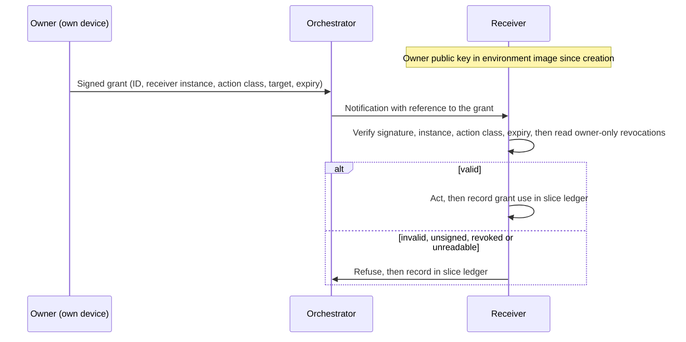

# Governed semi-autonomous development: Control reference

*This document is for security and platform teams who implement the method's controls: what each control prevents, what it costs, which profile requires it, what keeps it and what proves it. The method itself, including the profiles, is in [method.md](method.md); the procedures are in [practice.md](practice.md); the terms are in [glossary.md](glossary.md); one concrete tool mapping is in [claude-code-reference.md](claude-code-reference.md).*

---

## How to read this reference

Each layer section gives a control table, then the rules that need more than a table row. Columns:

- **Prevents**: the failure the control exists to stop.
- **Serves**: S (secure), C (correct), E (efficient).
- **Cost**: what the control costs to run.
- **Profile**: the lowest profile that requires it. A control required at Lite also applies at Standard and High, unless a higher profile replaces it (stated as "Lite: …; Standard: …"). A control required at Standard also applies at High.
- **Kept by**: what keeps the control in force: an expectation, a setting or a boundary (below).
- **Proof**: the artefact that shows the control operates, tagged by its source:
  - **independent**: produced and stored outside every agent environment it describes, such as by the repository host, CI, infrastructure outside the agent environments, or a signature checked against the owner's key. The internal remote, the message transport and the broker count only where they run outside every agent environment. Where the artefact proves only part of the control, the cell names that part;
  - **self-attested**: written by an agent session, such as the ledger, the kickoff record, review records, hand-over notes and ritual output.

  A configuration file shows what was set, not that it held. Self-attested proof is only as strong as the session that wrote it, so an assessor corroborates self-attested proof first, for example against the host's records.

### Capability, mandate and what keeps the gap closed

Each control can be read through three questions:

- **Capability**: what the agent can do, with its tools, credentials and reach. Here the word means what an agent can do, not a capability from the method's library.
- **Mandate**: what the agent may do, given its role, its baseline and any grant.
- **The gap**: what the agent can do but may not. Each control keeps part of that gap closed.

The Kept by column names what keeps it closed:

| Kept by | Meaning | Holds while |
|---|---|---|
| **Expectation** | A rule in a brief, instruction or checklist that the agent is expected to follow | The agent follows it. Injected content, a stale summary or an ambiguous instruction can break it |
| **Setting** | Tool or host configuration that refuses the action | The session cannot write that configuration (L3, Enforcement material), and the setting matches every form of the action. A rule that matches command text holds against mistakes, not against an adversary (L3). A setting the session can change is only an expectation |
| **Boundary** | An environment, system or party the session cannot reach or change | The boundary stands, whatever the agent does |

A ritual makes an expectation identical every time; it does not make it refuse. Where a cell names two values, the control combines them, or the value changes with the profile.

**Kept by and Proof answer different questions.** Kept by says what holds the rule. Proof says who vouches that it held. An egress allow-list is a boundary with independent proof: a firewall deny log outside the environment. A deny rule is a setting with self-attested proof: the kickoff record of a refusal. A review is an expectation with self-attested proof, the weakest pairing: nothing refuses the action, and only an agent says the rule held.

**The learning loop moves rules outward.** A first breach produces an expectation. A rule that breaks twice becomes a mechanism ([method.md](method.md), §11), which moves it toward a setting, and, where it must hold against an adversary, toward a boundary. Kept by shows where each control stands on that path. The framing is adapted from a practitioner's reading of the method ([related-work.md](related-work.md)).

### Where the rest is

The layer objectives and the profile table are in [method.md](method.md) (§5, §12). The control-to-profile map at the end of this document is the per-control form of that table. Terms are defined in [glossary.md](glossary.md). Placement against common security frameworks is in [related-work.md](related-work.md) (Standards and frameworks).

## L1 Infrastructure isolation

| Control | Prevents | Serves | Cost | Profile | Kept by | Proof |
|---|---|---|---|---|---|---|
| Isolated environment | A command that deletes, fills or rewrites more than intended, hitting the owner's workstation | S | Setup; slower first start | Lite: a dedicated development machine, or one isolated environment shared by the sessions. Standard: split by authority and input trust (below). High: VM per session | Boundary | Self-attested: environment definition, environment list in the ledger |
| No host or production credentials mounted or forwarded (SSH agent, git credential helpers, cloud CLI sessions) | Agents, or content they read, reaching production or personal accounts | S | Owner performs credentialed steps | Lite | Boundary | Self-attested: kickoff record of a refused credentialed action |
| Destructive and adversarial tests only against stubbed copies or throwaway stores | One test taking down the environment that every session shares | S, C | Stubs and seed scripts | Lite | Expectation. Standard: setting where an L3 hook covers it | Self-attested: test configuration, hook tests |
| Orchestrator environment runs no product code and no fetches | Worker-written code or fetched content running with the orchestrator's authority: its integration push credential, ledger ref and grants | S | Integrated suites and regeneration in CI; a narrow egress allow-list | Standard | Setting (fetch tools denied); boundary (a narrow egress allow-list); expectation for product code | Independent (partial): CI runs of the integrated suites show where they ran, not that the orchestrator ran nothing; the egress deny log outside the environment. Self-attested: the role set, kickoff record |
| Fetch tools denied outside ingestion environments | Untrusted input reaching a session that was not assigned to ingest it | S | Research routed to ingestion sessions | Standard | Setting (the role sets deny fetch tools) | Self-attested: role sets, kickoff record |
| Egress allow-list | Exfiltration; fetching unreviewed code | S | List upkeep; blocked legitimate fetches | Standard | Boundary | Independent: deny log of a firewall outside the environment |
| Throwaway data stores per session | Destructive tests corrupting long-lived data | S, C | Seed and teardown scripts | Standard | Boundary | Self-attested: environment definition, seed and teardown scripts |
| Lab separate from production | A test deployment mistaken for, or wired into, production | S | Extra environments | Standard | Boundary | Independent: separate accounts or networks recorded by the infrastructure provider |
| Per-environment, least-scope credentials | A leaked credential with wide reach or no revocation path | S | Issuing and revoking per environment | Standard. High: per session | Boundary | Independent: the issuer's records of issue and revocation |
| Segmented network; ephemeral environments | Lateral movement; drift in long-lived environments | S | Provisioning automation | High | Boundary | Independent: network configuration and provisioning logs outside the agent environments |

Agents run commands faster than anyone can review them line by line. A guard test aimed at the filesystem root, or a cleanup aimed at the wrong target, is an ordinary mistake. Isolation turns it into a lost environment, not a lost workstation. Guards are tested against stubbed copies of the commands they guard. Every change to a lab environment made outside the normal deploy path is preceded by a backup and logged with its exact revert command.

### Why sessions are separated, and how far

Lite: all sessions share one environment, or the dedicated development machine. A dedicated development machine is one the owner never performs outward actions from and that holds no owner credentials; its enforcement material is owned by another OS user or delivered as managed settings. Standard: as below. High: one VM per session.

Separating sessions is privilege separation. Sessions differ in authority, and in how far their input can be trusted. Without an environment boundary those differences are declared, not enforced.

- **Permission sets need a boundary behind them.** The orchestrator holds integration branches and carries grants; a worker holds one branch. Under one OS user on one filesystem, a worker can rewrite the orchestrator's settings, hooks or ledger, and a shared `.git` runs the same hooks in every session.
- **Untrusted input meets the least authority.** Sessions assigned to fetch pages, run research, or triage external issues, advisories or dependency material carry the largest injection surface. A misled session acts with whatever its environment reaches. Every session also reads some untrusted text in installed dependencies, logs and tool output; that surface rests on L3 and on the review of what the session produces.
- **Accidents cross shared boundaries too.** A reused stack name, a filled disk, a shared stash or concurrent operations on one object store affect every session that shares them.
- **Credential scope and attribution** depend on sessions not reading each other's credentials and identities.

What separation does not buy: it does not protect the product, because a misled session's output still reaches main through integration, where reviews and CI may stop it (method §12, Product code and human review). The orchestrator still reads ingestion output, so injected text that survives into a summary reaches it second-hand; L4 bounds what that text can make it do. It does not help against the model itself. It costs setup, disk, start time, an internal remote and a cross-environment channel.

The boundary therefore follows the two properties that justify it, not the number of sessions. At Standard:

- **The orchestrator runs in its own environment.** The owner's checkout stays outside every agent environment (L4). The orchestrator's environment never executes product code and never fetches. Integrated suites and hot-file regeneration run in CI, fetching subagents and research capabilities run in an ingestion environment, and the orchestrator reads their results by commit. Its role set denies fetch tools, and its environment's egress allow-list admits only the model API, the internal remote and the host.
- **Workers of equal authority may share one environment**, with a worktree each and the rules for a shared environment (L2). Equal authority means the same role permission set; tiers do not change it. That role set denies fetch tools. What one worker reaches, all of them reach: this is a recorded Standard residual ([method.md](method.md), §12).
- **A session assigned to external ingestion or destructive work gets its own environment.** External ingestion means fetch tools, research capabilities, and triage of external issues, advisories or dependency material; reading installed dependencies and the session's own tool output does not count. Destructive work means anything that targets a store other than the session's own throwaway stores, such as lab writes, or tests against a lab target the brief names.
- **Fetch tools are denied to every session not assigned external ingestion.** An egress allow-list alone does not keep them out: some search tools run at the model provider, so their queries and results pass any allow-list. Adding a new dependency is a decision recorded in the slice plan. Reading the source of installed dependencies is not ingestion; it rests on L1 and L3 and is a recorded residual ([method.md](method.md), §12).
- **Subagents and capability runs count as sessions for this rule.** A fetching subagent or a research capability runs in an ingestion environment, never inside the orchestrator's, and the orchestrator reads its committed output.

**Usage and cost.** Each environment authenticates to the model provider with its own least-scope credential. That gives cost attribution per environment, a spend cap, and a smaller blast radius if a key leaks. Usage limits are set by the provider's plan. Where a plan gives separate allowances per account or seat, and its terms allow assigning them to agent environments, environments may use separate ones (optional); check the terms first. Separate API keys within one organisation usually share its limits.

### Credential scope

Some credentials cannot be denied, because the session needs them: the model API key, push credentials for the internal remote, lab credentials, broker credentials and, in the session that opens PRs, the PR-opening token (L5). At Standard, each is per environment and least-scope; at High, per session:

- a model key with a spend cap;
- push credentials limited to the internal remote;
- lab credentials per environment at Standard; at High, per session and per lab slot;
- a PR-opening token with pull-request write only: no push, merge or tag.

All are revoked at teardown. Each one is treated as readable by anything the session runs.

## L2 Session isolation

| Control | Prevents | Serves | Cost | Profile | Kept by | Proof |
|---|---|---|---|---|---|---|
| One session per worktree or clone, one branch per session | Two agents in one checkout; edits on the wrong branch | S, C | Disk; one install per environment | Lite: worktree. Standard: clone per environment; worktrees inside a shared worker environment | Lite: expectation. Standard: boundary between environments | Self-attested: environment list in the ledger |
| No standing ("don't ask again") approvals; permission rules only in owner-applied settings | Approvals given in one session silently applying in others | S | One prompt per action | Lite | Setting where the tool can turn standing approvals off; otherwise expectation | Self-attested: settings files, kickoff record |
| Unique project names and ports per session; shared-resource registry | One session's stack replacing another's through a reused project name, port or container; silent collisions on lab slots and branch names | C, E | One committed file kept current | Lite, where more than one session runs services | Expectation | Self-attested: the registry |
| Own runtime per environment | Shared processes and caches between environments. Inside a shared worker environment, separation is by convention | C | One runtime per environment | Standard | Boundary between environments; expectation inside a shared one | Self-attested: environment definition |
| Own identity per environment | Unattributable actions; borrowed credentials across environments. Co-located workers share the environment's identity. The channel authenticates the environment; the session name within it is self-declared, and attribution among co-located workers rests on that name and the launch records in the ledger | S | Identity provisioning | Standard. High: separate OS identity and credentials per session | Boundary between environments; inside a shared worker environment, session names (expectation) | Independent: the issuer's identity records; the internal remote's access log where the remote runs outside every agent environment |
| Internal git remote as the only shared repository surface | Shared writable `.git` across environments | S, C | Running the remote | Standard | Boundary | Independent where the remote runs outside every agent environment: the remote's access log |
| Per-ref push enforcement | One session altering another's branch | S | Ref permissions on the remote | High | Setting on the remote | Independent where the remote runs outside every agent environment: the remote's ref permissions and refused-push log |

### Shared repository across environments

From Standard, each environment holds its own clone. An internal git remote is the only shared surface:

- Workers push only their own branches. At High this is enforced per ref.
- The orchestrator fetches and integrates.
- Inspection of uncommitted work uses a read-only mount.

Environments never share a writable checkout or `.git` directory. Shared refs, stash and hooks would let one session alter or execute code in another. Concurrent operations on a shared object store can also see each other's partial state and report false errors. Pushing to the internal remote is a separate permission from pushing to the public host.

### Worktrees in a shared environment

At Lite, and inside a shared worker environment at Standard, worktrees in one isolated environment are enough. They separate files and branches. They do not separate `.git`, the stash, hooks or local tool approvals.

- **Shared `.git`, stash and hooks are accepted**, because the shared environment is itself isolated from the host and from sessions of other authority. The consequence is that compromise of one session is compromise of every session in the environment. This is a recorded residual at Lite and Standard ([method.md](method.md), §12).
- **Shared approvals are not accepted.** No profile allows standing ("don't ask again") approvals. Permission rules live only in settings files that the owner applies.

## L3 Tool control

| Control | Prevents | Serves | Cost | Profile | Kept by | Proof |
|---|---|---|---|---|---|---|
| Deny push, publish, secret reads | Outward actions by agents; credentials in context | S | Owner performs those actions | Lite | Setting; boundary: no public-host or publish credential in the environment (L1) | Self-attested: permission files, kickoff record |
| Enforcement material read-only to the session | A session widening its own limits | S | File ownership and placement at setup | Lite | Boundary | Self-attested: kickoff record of refused writes |
| Enforcing checks fail closed | A crashed or timed-out check letting actions through | S | Error handling in every check | Lite | Setting | Self-attested: check tests, kickoff record |
| Agent tooling only from an owner-approved list | Unreviewed plugins, tool servers or scripts running in every session | S | List upkeep | Lite. Standard: pinned versions, auto-update off, changes through the protected-path review | Lite: expectation. Standard: setting | Self-attested: the approved list, environment definition |
| Pre-execution hooks for environment rules | Known rules broken under load | S, C | Writing and testing hooks | Standard | Setting | Self-attested: hooks and their tests |
| Wrapped commands | Risky tools run with unsafe defaults or targets | S, C | Wrapper upkeep | Standard | Setting where the raw command is denied; otherwise expectation | Self-attested: wrappers and their tests |
| Allow-list only | Any tool use not foreseen for the role | S | Frequent list updates | High | Setting | Self-attested: permission files, kickoff record |
| Action classifier on side-effecting calls | A permitted tool used outside the task: destructive, exfiltrating or access-acquiring calls the rules allow; actions driven by instructions in fetched content | S | A self-hosted decision engine shared with L6; latency on side-effecting calls; local calibration | High | Setting | Self-attested: calibration records, decision log |

### Enforcement material

A session cannot write what enforces its limits:

- permission settings;
- hooks and hook scripts;
- the trust anchor;
- the grant manifest;
- the revocation records;
- the mailbox tool and its filter configuration, where filtering runs in it (L6).

These are read-only to the session, or held outside its environment. The kickoff tests try to modify each one and record the refusal ([practice.md](practice.md), §2).

### Fail-closed checks

Every enforcing check fails closed. An error, a crash or a timeout in a check counts as deny. The kickoff tests remove a check's input and confirm the guarded action is refused.

### Agent tooling supply chain

The agent's own tooling is controlled like product dependencies:

- the agent CLI version;
- plugins and tool servers;
- skills and subagent definitions;
- hook scripts;
- models.

Tool servers and hooks often run outside the shell sandbox. A tooling change committed inside a slice reaches every session after a merge.

### Environment rules worth a hook

- Live test suites target a dead endpoint unless the brief names a lab target.
- No container or database starts outside throwaway environments.
- No reads of environment files or credential stores.
- No deletion of a remote branch until the merge is confirmed and the trees compare equal.

### Rule text is not a boundary

A deny rule that matches command text covers the usual form of a command. It does not cover a full path, a shell wrapper or a re-spelled flag. Deny lists catch mistakes. The boundary against a determined adversary is L1. A rule that must hold needs an OS-level sandbox, or a hook that inspects the full command and is tested against evasions.

### The action classifier (High)

Rules decide which tools a role may use. They cannot tell a permitted tool used for the task from the same tool used against it. At High, a calibrated action classifier checks for that misuse.

- **Position.** Deny and allow rules run first, then the deterministic hooks. The classifier sees only calls the rules allowed.
- **Scope.** Only side-effecting calls are checked: shell commands, network access, writes outside the session's worktree, and tool-server calls with effects. Reads are not checked, because the latency would fall on every call.
- **Questions.** The classifier answers signal questions: is the call destructive, is it exfiltrating, does it acquire access or credentials beyond the task, does it follow from instructions in fetched content?
- **Scope check.** Whether a call is within the slice's scope has a deterministic answer, so it is not left to a model. A named hook step checks the call against the closed action classes and the approved plan's files, resources and environment needs. Where L4 is below High, the closed list of action classes is fixed at kickoff for L3 alone.
- **Context from trusted sources only.** The classifier and the scope check read the slice plan, or the batch plan that covers the slice, at the commit the approver said "go" on, which the ledger records. A deviation enters only after re-approval. The classifier also receives the delegation manifest and the provenance of the content that preceded the call. It never receives the agent's own justification, because whoever writes the context steers the verdict.
- **The call is agent-written too.** The agent's description of the call, and comments inside it, are stripped before classification. The calibration set includes calls that carry text aimed at the classifier.
- **Outcomes.** Pass; block, recorded for batch review; or, for a grantable action class, the session's L4 grant path. At Standard L4, that is the tool's permission prompt in the receiving session. At High L4, it is a refusal that names the class, which the orchestrator can turn into a grant request to the owner. A permission prompt is never answered by another session. The classifier fails closed and never feeds the owner's decision queue directly.
- **One engine.** It shares the decision engine and the thresholds discipline with the L6 decision classifier. Each decision point (the gateway, content ingestion, action calls) has its own labelled set, thresholds and coverage, because thresholds fitted on messages do not hold on tool calls.

**Residual risk.** As in L6: the classifier is probabilistic, catches some misuse rather than all of it, and never confers authority.

## L4 Permission sets and delegation

| Control | Prevents | Serves | Cost | Profile | Kept by | Proof |
|---|---|---|---|---|---|---|
| Owner performs all outward actions, from a checkout agents cannot write | Any agent acting outward; agent-planted hooks or configuration running with the owner's credentials | S | Owner time; a separate checkout | Lite | Boundary | Independent (actor only): the host's record of who merged, tagged and published. Self-attested: that it was done from a checkout agents cannot write |
| Role permission sets | Workers holding orchestrator or owner powers by default | S | One set per role | Standard | Setting | Self-attested: permission files, kickoff record |
| Delegation manifest | Authority whose source, scope or expiry nobody can state | S | Upkeep | Standard | Expectation (a record) | Self-attested: the manifest |
| Planned delegations translated into tool configuration and exercised at kickoff | The tool refusing what the owner delegated, and every refusal bouncing to the owner | S, E | Translation and a kickoff test per delegation | Standard | Setting | Self-attested: kickoff record, printed effective configuration |
| Grants as the owner's answer to the tool's own permission prompt in the receiving session | Authority passed on through an intermediary or imitated in conversation | S | Owner acts in each receiving session | Standard | Setting | Self-attested: grant uses in slice ledgers |
| Signed kickoff manifest as the baseline across environments, verified against the owner's public key provisioned into each environment image at creation | A forged or altered baseline arriving over the bus | S | Signing tooling; image rebuild on rotation | High, where sessions run in separate environments | Setting (the receiver's check); boundary (the signing key stays on the owner's device) | Independent: the signed manifest, verifiable against the trust anchor |
| Owner-signed, instance-bound, time-bound grants verified by the receiver | Forged or replayed grants across separate environments | S | Signing tooling; key management | High (needs L1 or L2 at High) | Setting (the receiver's check); boundary (the signing key stays on the owner's device) | Independent: signed grant and revocation entries, verifiable against the trust anchor |
| Two-party rule for releases: owner + human reviewer, or owner + independent verifier with a required signed verdict for a sole owner | A mistaken actor or a compromised agent releasing; a release built on fabricated evidence | S, C | A second party per release; for a sole owner, a separate trust domain to run and its own evidence rebuild | High | Boundary: a second human, or for a sole owner a verifier in a separate trust domain | Independent: the verifier's signed verdict, or the second reviewer's approval on the host |

### Where the owner acts

The owner performs outward actions from a checkout that agents cannot write, after fetching the reviewed ref into it. The owner never acts inside an agent environment. An agent can plant git hooks, git configuration or package scripts in its own checkout, and these would run with the owner's credentials. Committed scripts can do the same, so a publish step runs no repository scripts and publishes, by digest, artefacts built in CI or in an agent environment (L5). The owner also pushes each vehicle branch to the host from this checkout (L5, Who opens the PR). At Lite on a dedicated machine, agents run as the owner's user. That residual is recorded ([method.md](method.md), §12).

### Permission sets must express the delegation

Enforcement reads configuration, not conversation. At kickoff, every planned delegation is translated into the tool's own configuration. Examples:

- the orchestrator tagging a release;
- writing a gate value;
- writing to a lab environment.

The translation covers the permission rules and, where the tool has one, the allowances of its safety classifier or automatic approval mode. Without it, the tool refuses what the owner delegated. Kickoff exercises each planned delegation once.

Delegations not planned at kickoff go back to the owner, who either performs the action or issues a grant. An agent never works around a refusal. A repeated refusal of the same delegated class is handled as an incident ([method.md](method.md), §11).

### Baseline and grants

Authority is valid only where the owner gives it. The two levels are summarised in [method.md](method.md) (§5, L4). The detail:

- **Baseline.** At kickoff the owner establishes, in each environment:
  - who its orchestrator is (pinned identity);
  - what the orchestrator may assign (in-scope slices, plan approvals, rulings);
  - the session's own limits.

  At High, across environments, the baseline is a signed kickoff manifest. The trust anchor is the owner's public key, provisioned into the environment image at creation; it never arrives over the bus. Every baseline at every level is owner-signed (High) or owner-applied (Standard); at Lite, it is the owner's own settings in the one environment.
- **Grants.** Grants cover actions beyond the baseline, such as an infrastructure write, a permission exception or a production action. At High, a grant is a signed manifest entry naming scope, receiving session and expiry. The orchestrator may carry it; carrying a signed grant is not relaying. The receiver accepts it only because the signature verifies.

**What can catch misdirection inside the baseline.** A compromised orchestrator or bus can misdirect work inside the baseline. Only controls the orchestrator does not run can catch that:

- required CI;
- the protected-path review;
- the owner's merge;
- at High, the external reviewer, the independent verifier and the human reading of high-risk slices.

None of them reads every product change ([method.md](method.md), §12, Product code and human review).

### Nested delegation

- A function lead's baseline is bounded by the project's.
- A worker's pinned orchestrator is its lead.
- The project orchestrator instructs leads, not workers.
- A session added to a standing team runs the start self-check when its environment and launch configuration were already tested, and a kickoff otherwise ([practice.md](practice.md), §2).
- Grants beyond the baseline go owner-signed directly to the receiver. They are never relayed down levels.

### Grant rules at High

- **Instance binding.** Each grant carries a unique ID. It is bound to the receiving session *instance*, meaning the per-session credential or instance ID issued at kickoff, not the session's name. It is valid for any action in its scope until it expires or is revoked. Replay protection is instance binding plus expiry. Expiries are kept short. A new session, including one started by tier escalation, is a new instance: it receives its own instance credential before its start self-check, and grants are re-issued to it.
- **Closed scopes.** Grant scopes come from a closed list of grantable action classes, fixed at kickoff.
- **Signing on the owner's device.** The owner signs on the owner's own device. The device shows a rendering of the exact bytes being signed: receiver instance, action class, target and expiry. The decision message shows the same rendering. The private key never enters an agent environment or the repository.
- **Revocation.** The owner can withdraw a grant before expiry with a signed revocation. Receivers read revocations from a location only the owner can write, such as an owner-only protected ref on the internal remote. If that location cannot be read, the check fails closed. Expiry is the hard bound; revocation is best-effort.
- **Trust-anchor rotation.** Revocation covers grants, not the owner's key. If the owner's signing key or device may be compromised, the trust anchor is rotated. A new key pair is made. Every environment is torn down and recreated from an image with the new public key, and everything the old key signed (kickoff manifests, grants) is re-issued. Until then the suspected-compromise stop applies ([practice.md](practice.md), §9).

### Grants across profiles

- **Lite:** no grants. The owner performs the action.
- **Standard:** grantable action classes are configured to ask. A grant is the owner's answer to the tool's own permission prompt in the receiving session. Conversation text is never a grant, whoever it appears to come from. With standing approvals forbidden, each answer covers one action.
- **High:** sessions run in environments the owner cannot attend directly. A receiver cannot tell who wrote pasted text, so signatures replace direct presence. No permission prompt stands in for a signed grant.

**Refusals at Standard.** A receiver refuses a grant when:

- it did not come through the tool's permission prompt (for example, conversation text or a relayed message);
- it was given in another session;
- its scope does not cover the action;
- it was recalled from a summary instead of re-read and verified.

**Additional refusals at High.** A receiver also refuses a grant when:

- the signature does not verify;
- it was issued to another session instance;
- it has expired;
- a revocation covers it, or the revocation location cannot be read;
- its action class is not on the kickoff list.

### The two-party release rule

At High, a release needs two independent parties: the owner and a second reviewer. Where a second human exists, the second reviewer is human. Where the owner is alone, the second party is an **independent verifier**: an agent session in a separate trust domain, with its own environment, credentials and owner-applied configuration.

- **It rebuilds its own evidence.** The verifier receives only the release commit and the release run sheet. It builds the artefacts itself, computes the digests and runs the tests. It does not trust the initiative's copy of the evidence, because a compromised session can fabricate evidence that looks consistent.
- **Its verdict is deterministic and signed apart.** The verdict is the result of the rebuild: the digests match and the tests pass. A separate step that runs no repository code and no model signs it over the release digest, with a key held outside the environment that builds and tests. The release step checks that signature. The verifier verifies. The owner releases.
- **It is independent verification, not segregation of duties between people.** Report it as such.
- **Releasing without it is a downgrade.** The owner may still release without a passing verdict, but only as an exception in the decision register, with a named acceptor and a review date ([method.md](method.md), §12). That decision downgrades that release to Standard, and the run sheet records the downgrade.

**Residual risk.**

- The independent-verifier form covers a mistaken actor and a compromised agent.
- It does not cover a compromised owner: a sole owner who is compromised can still release by taking the recorded downgrade.
- A verifier on the same model family shares that model's blind spots. A different model or provider for the verifier, where possible, reduces this.

## L5 Repository controls

| Control | Prevents | Serves | Cost | Profile | Kept by | Proof |
|---|---|---|---|---|---|---|
| No commits on main; PRs | Unreviewed changes on the release line | S, C | PR overhead | Lite | Setting (branch protection) | Independent: branch protection, the host's merge history |
| Owner-only merge and tag | Agents creating outward history | S | Owner time | Lite | Setting (host rules that restrict updates to main and tag creation to the owner, where the host plan allows); boundary (agents hold no credential for it) | Independent: the host's record of the merge and tag actor; tag rules |
| Agent PR identity: the owner pushes the vehicle branch; an agent identity with pull-request write only opens the PR | An author approving its own change; a host credential in an agent environment that can push, merge or tag | S | A second identity on the host | High, wherever L7 is High; recommended below | Setting (the identity's host permissions) | Independent: the host's permission record and the PR's author and reviewer records |
| Boundary scans, including the ledger ref | Private paths, names or identifiers leaking into a public repository | S | Scan upkeep; false positives | Lite, where a public mirror exists | Lite: expectation (the pre-PR gate). Standard: setting (a required CI check) | Self-attested: pre-PR gate output. Independent from Standard: the CI scan conclusion |
| Fresh integration branch per merge vehicle, owned by the orchestrator | Slices merged without integrated testing; force pushes to reset a used branch | C | Branch upkeep | Standard | Expectation | Independent where the remote runs outside every agent environment: the internal remote's branch history |
| Required CI, enforced by the host | Merges that rest on an agent's report or pass only locally; a ritual or agent skipping a check | S, C | CI time and cost | Lite: minimum set. Standard: full suite | Setting | Independent: required checks in branch protection; the host's check conclusion per merged commit |
| CI kept out of band | Agents influencing, skipping or forging their own verification; secrets exposed to unreviewed code; release credentials meeting repository code | S | Runners separate from agent environments; workflow discipline; a separate publish step | Lite | Boundary for execution and credentials; what CI runs is kept by the protected-path review | Independent: the host's workflow permissions and environment rules, runner placement |
| Protected-path review | Changes to the enforcement, verification and release machinery travelling the same path as feature code | S | Owner reads those diffs; one fixed security pass | Lite: CI workflows, the configuration and scripts CI invokes, and agent instruction files reach the owner as the diff; the pre-PR gate lists changed protected paths in the PR body. Standard: all protected paths, with the security pass | Lite: expectation (the pre-PR gate lists the paths). Standard: setting where code-owner rules enforce it | Lite: self-attested (the pre-PR gate's list), or independent where the owner takes the list from the host's changed-file list. Standard: independent where code-owner rules enforce it and an agent identity opens the PR: the rules and the host's review record |
| Signed commits and tags | Forged or unattributable history | S | Key management | High | Setting | Independent: signatures |
| Reproducible builds | Artefacts that cannot be tied to source | S, C | Build hermeticity | High | Boundary (an independent build) | Independent: matching digests from an independent build |

### Integration branches

After a merge vehicle merges, the next vehicle's integration branch is cut fresh from main, and workers rebase onto it. No force push, backup branch or reset is needed. The post-merge ritual prunes old branches after confirmation.

### Who opens the PR

The owner pushes the vehicle branch to the host from the owner's checkout (L4). An agent identity opens the PR from that branch. Its token has pull-request write only: no contents write, so it cannot push, merge or tag. The kickoff tests try a push, a merge and a tag with it and record the refusals. Host rules restrict updates to main and tag creation to the owner where the host plan allows; where it does not, that is a recorded exception ([method.md](method.md), §12).

Keeping the author and the approver apart lets the host record the owner's review as a separate act. The human reading of high-risk slices needs that (L7), and so does code-owner enforcement, because a host does not let an author approve its own PR. Where only the owner's account exists, the owner opens the PR, and approvals recorded for it are self-attested.

### Out-of-band verification

CI is the method's out-of-band verifier. It runs outside every agent environment, on infrastructure agents cannot write, with credentials agents do not hold. When branch protection requires the branch to be up to date, or a merge queue is used, it runs against the exact commit that will merge. Its result is deterministic and recorded by the repository host. Every other check before a merge runs inside an agent environment and reaches the owner as an agent's report, rituals included. CI is the one result the agents cannot produce for themselves.

What CI proves is narrow. It proves that the committed checks ran and passed on that commit. It does not prove that they are adequate, because agents write most of the tests it runs. Adequacy rests on review, red-first fixes and mutation checks, and on the rule that agents cannot change what verifies them.

Five rules keep it out of band:

- **The host enforces the gate.** Branch protection requires the checks before a merge, so neither an agent nor a ritual can skip them. Bypassing them is an exception: an owner decision in the decision register, with a named acceptor and a review date ([method.md](method.md), §12).
- **Agents cannot change what verifies them.** CI workflows, and the configuration and scripts they invoke to reach a verdict (test-runner, lint and scan configuration, allow-lists), are protected paths at every profile. Workflows triggered by agent changes get no secrets and no write tokens.
- **Release credentials meet no repository code.** Only workflows running reviewed code from main hold release credentials. The step that holds them runs no repository code: it receives artefacts built in an earlier step without those credentials, and only publishes them, with package scripts disabled.
- **Runners are separate from agent environments.** A self-hosted runner never shares a host, a network segment or credentials with an agent environment.
- **Results are read from the host, by commit.** A merge or release decision cites the host's conclusion for the exact commit. Sessions read it with a read-only token scoped to checks, issued per environment, never with the owner's token. The kickoff tests confirm that a merge or tag through the host's API is refused. An agent's "CI is green" is a claim. "Pending" is not green.

The minimum set at every profile is the build, the test suites, type and lint checks, and a secret scan. Standard runs the full suite, including slow and database suites. At every profile with a public mirror, the boundary scan runs in the pre-PR gate; from Standard it also runs in CI. At High, CI is the deterministic half of release verification, and the second reviewer or independent verifier is the judgement half. Neither replaces the other.

Some hosts offer branch protection, rulesets or deployment approvals only on paid plans or only for public repositories. Where the host cannot enforce a rule, that is a recorded L5 exception ([method.md](method.md), §12): the owner's merge ritual reads the host's conclusion by commit and refuses anything but success.

CI time is a real cost. The economy rules ([method.md](method.md), §10) keep it proportionate: local gates first, one CI run per vehicle, and a branch goes to CI only when it is ready to pass.

### Protected paths

Changes to these paths reach the owner as the diff itself. This is one of two exceptions to "decisions, not files"; the other is the human reading of high-risk slices at High (L7). The protected paths are:

- permission sets;
- hooks and hook scripts;
- CI workflows, and the configuration and scripts they invoke to reach a verdict: test-runner, lint and scan configuration, allow-lists;
- the release kit and gate definitions;
- environment definitions;
- trust anchors;
- agent instruction files: project and agent instructions that steer every future session.

From Lite, CI workflows with what they invoke, and agent instruction files, reach the owner as the diff, and the pre-PR gate lists every changed protected path in the PR body. From Standard, every protected path does, and a security pass reviews each such change. Its brief is a fixed ritual that the orchestrator does not author. At Standard this can be a code-owners rule on the repository host, which needs PRs opened by the agent identity.

- **The list is closed.** The protected paths are listed by path at kickoff, in a file that is itself protected. Where a manifest mixes scripts and dependencies, a change to its scripts section is the protected change.
- **The owner takes the list from the host.** At Lite, the owner's merge ritual takes the changed protected paths from the host's changed-file list for the PR, not from the PR body.

## L6 Message controls

| Control | Prevents | Serves | Cost | Profile | Kept by | Proof |
|---|---|---|---|---|---|---|
| Authority never relayed | Escalation through a trusted intermediary | S | Owner acts in the receiving session | Lite | Setting: a message cannot change what the session may do | Self-attested: refusals recorded in slice ledgers, kickoff record |
| Local messaging with tool-attributed senders | Misattributed senders by mistake on one machine | S | None | Lite | Setting | Self-attested: written inside the shared trust domain |
| Content as repository references | Unreviewable or injected payloads; context bloat | S, C | Commit before notifying | Standard | Expectation. High: setting (broker size and schema limits) | Independent where the audit store is outside every agent environment: references in the transport's message audit |
| Authenticated messaging, with an authenticated cross-environment channel where sessions run in separate environments; message audit written by the transport | Untraceable instructions; ad-hoc channels without sender identity | S, C | Running the channel; audit storage | Standard | Setting (authentication); boundary where the audit store is outside every agent environment | Independent where the audit store is outside every agent environment: the transport's message audit |
| Private bus with the full requirements below | Spoofing, eavesdropping and misrouting across environments | S | Running a broker | High | Boundary | Independent where the broker runs outside every agent environment: broker configuration, ACLs and broker log |
| Filtering and provenance on untrusted content | Instructions hidden in fetched pages, issues, logs or package metadata | S | Filter upkeep | High | Setting | Independent where the broker or gateway runs outside every agent environment: its filter log. Self-attested where filtering runs in the receiver's mailbox tool (end-to-end option) |
| Decision classifier at the gateway and content ingestion | Injected instructions that pass the deterministic checks and reach a reading agent | S | Self-hosted model; local calibration; added latency at the filtered points | High | Setting | Self-attested: calibration records, decisions in the ledger |

### References, not payloads

A slice plan, finding or decision request lives in a committed file, and the message only says where. This leaves a reviewable record and limits what a forged message can carry.

### Context sharing

How much context sessions share is a trade-off. Fuller shared context, such as another session's full trace, lets agents see each other's implicit decisions, which serves correctness and saves re-discovery. References only keep each session's context small and limit what an injected or forged payload can reach, which serves security.

The rule follows the environment (L1), not the L6 profile:

- **Within one environment, and subject to the two rules below, fuller context may be shared**: at Lite, between all sessions; from Standard, between the workers in a shared worker environment. Those sessions already share one trust domain, so references alone buy little security there. At Lite, a forked session within the one environment is one form of it (never for tier escalation).
- **Never out of a session that ingested untrusted content.**
- **Never into a reviewer, a blind judge or the independent verifier.** Their value is fresh context ([method.md](method.md), §6).
- **Everywhere else, references only.**

The cost of fuller context: content injected into one session's context reaches every session that receives it. The recorded residuals for a shared environment cover it ([method.md](method.md), §12: the second Lite residual and the first Standard residual). At every profile, assumptions and decisions travel as set out in [method.md](method.md) (§2.1, P4).

### The message bus

Once sessions run in separate environments, local session messaging no longer reaches across them.

- **Standard.** Sessions in separate environments communicate over an authenticated channel. It has per-environment credentials, the sending session's name stamped by the transport, and references instead of payloads.
- **High.** The channel is a private bus. The reference choice is a self-hosted broker with per-identity credentials and per-subject permissions (for example NATS), fronted by a small mailbox tool the agents call. Requirements:
  - reachable only on the private network, with no published interface;
  - mutual TLS and per-session credentials, issued at kickoff and revoked at teardown;
  - role ACLs: a worker reaches only its orchestrator; peers only through an allow-listed gateway;
  - sender identity stamped by the broker, never by the sender;
  - size and schema limits;
  - references instead of payloads;
  - filtering on externally sourced content;
  - a message audit written by the broker, holding metadata and hashes, not bodies.

Each session's inbound message policy is set at kickoff, so that expected messages arrive without the owner's help and unexpected ones are held.

**Option at High: end-to-end encrypted, sender-signed messages.** Each message is encrypted to its receiver and signed with the sending session's key, and the relay holds only ciphertext. Each message carries a unique ID and a timestamp under the signature, and the receiver rejects duplicates and stale messages. This removes the broker operator from the trust base: the broker can still delay, drop or reorder messages, but it cannot read, forge or replay them. Two consequences follow:

- Sender identity comes from the signature, checked against the session keys listed in the signed kickoff manifest. The broker's stamp remains as routing metadata.
- Filtering, schema checks and the decision classifier run where a message is decrypted: in the receiver's mailbox tool, and at the federation gateway, which becomes an endpoint. The mailbox tool and its filter configuration then join the enforcement material (L3). The broker keeps its ACLs, size limits and metadata audit, over ciphertext hashes.

This is an option at High, not a requirement. Messages still carry references, never authority, and the repository ledger stays the record.

### The decision classifier (High)

At High, a decision classifier adds one more filtering layer on top of the message controls above. It never replaces them, and it is never the boundary.

- **Order.** Deterministic checks run first: sender ACL, schema, size and the references-only rule. The classifier sees only what passes them.
- **Placement.** The classifier runs at named ingestion points: the federation gateway (peer messages), fetch tools and capability inputs.
  - Content read through ordinary tools, such as dependency source or tool output, is not covered. It rests on L1 and L3.
  - The classifier does not run on internal notifications. Those carry repository references and are low risk. Filtering them adds latency, and false positives would stall work.
- **Decisions.** The classifier returns a calibrated confidence. Two thresholds map it to one of three outcomes: pass, quarantine for review, or block. It fails closed: an error or a missing verdict counts as block. Every decision goes to the ledger with its confidence.
- **Thresholds from a target error rate.** The owner sets the error rate tolerated on items the classifier decides alone. The thresholds are fitted so that rate holds on the calibration set. Against an adaptive attacker it is not a bound, and it is not reported as a detection rate. Everything between the thresholds goes to review. The calibration record states the **coverage** at that target: the share decided without a reviewer. Coverage sizes the review load, and it shows what a stricter target costs.
- **Two decider models.** A single-pass encoder model serves the high-volume points: content ingestion and the L3 action classifier. A slower, calibrated reasoning model serves the low-volume, higher-stakes points: the federation gateway, and first-pass triage of the quarantine queue before a reviewer sees it.
- **Quarantine.** Quarantined items are reviewed in batches by an output-only reviewer. They never go into the owner's decision queue. A per-source quarantine ceiling stops a source that produces too many.
- **Local calibration.** Thresholds and temperature are fitted on the deployment's own labelled set for each decision point, or the model is fine-tuned on it with a calibrated-decision training recipe.
  - The set includes an injection corpus and real benign traffic.
  - It is versioned, and its labels come from humans or deterministic sources.
  - The false-positive and false-negative rates and the coverage are recorded and re-evaluated on every model or threshold change.
  - The confidence a shipped model reports is not trusted as calibrated. A model can be calibrated across tasks pooled and still be off within one, so thresholds are fitted locally.
- **Inside the trust boundary.** The model is self-hosted or open-weight and runs without egress. Its weights are pinned by hash and verified before load.

**Residual risk.** A classifier is probabilistic. It catches some of what reaches the reading agent despite the other controls, not all of it. It never confers authority. Authority still comes only from the owner's signature.

## L7 Process controls

| Control | Prevents | Serves | Cost | Profile | Kept by | Proof |
|---|---|---|---|---|---|---|
| Plan and design review | Designs that are expensive to unbuild | S, C | A review round before work | Lite; Standard adds the security lens | Expectation | Self-attested: review records |
| Deliverable review on the final diff | Defects across slices; plan and code diverging | S, C | One review per vehicle | Lite | Expectation | Self-attested: review records |
| Pre-PR gate (ritual) | A PR opened without the checks its profile requires | S, C | One ritual run per vehicle | Lite: covering tests, final-diff review, leftover scan, changed protected paths listed in the PR body. Standard: + security review, acceptance-criteria trace, full leftover sweep. High: + high-risk slices listed in the PR body. Any profile: + boundary scan where a public mirror exists | Expectation (a ritual) | Self-attested: ritual output per vehicle |
| Leftover sweep | Debug code, stale flags, temporary bypasses, private references and working-document references left behind | S, C | One sweep per merge vehicle | Lite: a scan in every pre-PR gate. Standard: + the full sweep at every merge vehicle | Expectation | Self-attested: sweep results |
| Checkpoint review | Integration defects no single slice shows | C | One review per long build stretch | Standard | Expectation | Self-attested: review records |
| Acceptance-criteria trace | Criteria nobody checks until users notice | C | Trace upkeep | Standard, in the vehicle's pre-PR gate | Expectation | Self-attested: the trace |
| Property and mutation tests | Tests that pass whether or not the code is right | C | Generators; mutation runs | Standard | Setting where required CI runs them; otherwise expectation | Independent: CI conclusion where they run in CI. Self-attested: mutation reports |
| User-path end-to-end release gate | Defects that pass every in-repository test: missing generated data, packaging gaps, broken first install or upgrade | C | An end-to-end run on the published artefact | Standard | Setting (a release gate) | Independent: CI or release-run conclusion on the published artefact |
| Capability pilot → guard → scale, with contract gates | Failure classes multiplied by parallel runs; unreviewed content promoted | C, E, S | Contract and guard engineering before scale | Standard for any line that writes product content. Lite: pilot runs only | Expectation (the contract); its guards are settings | Self-attested: the capability's ledger |
| Human reading of high-risk slices | High-risk product code reaching main on agent review and CI alone | S, C | Owner time per high-risk slice | High | Expectation, backed by the merge gate | Independent (approval only): the host's record of the reader's approval, where an agent identity opens the PR. Self-attested: the ledger record, where only the owner's account exists |
| Multi-lens review | Defects outside one reviewer's habits | S, C | More specialist runs | High | Expectation | Self-attested: review records |
| Refute passes and blind judges | Findings adopted without challenge; a judge swayed by alternatives | C | More specialist runs | High | Expectation | Self-attested: review records |
| Rehearsed, reproduce-gated release kit | Releases failing half-way; artefacts differing from rehearsal | S, C | Kit engineering; rehearsal time | High | Setting (phase gates, run lock); boundary (an independent build) | Independent: digests from an independent build. Self-attested: the run sheet with its gate log |
| External reviewer | Blind spots shared inside the initiative | S, C | Peer time | High | Boundary (a party outside the initiative) | Independent: the reviewer's own record |

### Human reading of high-risk slices (High)

At High, a human reads the diff of every high-risk slice before the merge vehicle that carries it merges. The reader is the owner, or a second human where one exists. Agent review and CI can miss a defect or a planted change; this rule puts a human where a miss costs most. It extends the protected-path rule (L5) to the riskiest product code. "Decisions, not files" still holds for everything else.

- **What is high-risk.** A slice is high-risk when it touches security, authentication or authorisation; changes how sensitive or regulated data is stored, transmitted, logged or access-controlled; or changes a cross-cutting contract between components. The implementation plan and the slice plan carry the class.
- **Only the owner lowers a class.** Any reviewer can raise a slice's class. Only the owner lowers it, and a deviation that moves a slice into a high-risk area goes to the owner. The pre-PR gate lists the vehicle's high-risk slices in the PR body, checked against the owner-approved implementation plan.
- **Contracts are read early.** A slice that changes a cross-cutting contract is read when it reaches the integration branch, before dependent slices start. The vehicle's review still covers it.
- **Stale approvals are dismissed.** A new commit after an approval dismisses it, and the reading starts again.
- **The proof.** Where an agent identity opens the PR (L5), the host records the reader's approval. That is independent proof of an approval, not of a reading. Where only the owner's account exists, the approval is recorded in the ledger (and, for a release vehicle, in the run sheet), and it is self-attested.

What it does not cover is the residual at every profile ([method.md](method.md), §12).

### The release kit

The rehearsed, gated kit is a High control. Below High, a release follows the short checklist in [practice.md](practice.md) (§5). The kit runs in ordered phases:

1. **Dry run:** derive values and check preconditions.
2. **Rehearsal:** build artefacts and record digests.
3. **The no-return step.**
4. **Readback** against the rehearsal.
5. **Per-target steps.**

Each phase has a gate that the owner or a named reviewer sets. Five rules apply to every kit:

- Setting a gate and reading the log that justifies it are separate actions.
- Every phase takes a run lock, so runs cannot overlap.
- Rollback anchors are recorded before each phase.
- The kit is pinned for the whole freeze.
- The phase that holds publish credentials runs no repository code. It publishes the artefacts built in an earlier phase.

At least one digest comes from an independent build, because a check that compares an output with itself proves nothing. Pre-release checks run before the tag. If the owner releases despite a failed check, that is an exception in the decision register, with a named acceptor and a review date ([method.md](method.md), §12). If an emergency vehicle preempts the freeze, the kit re-rehearses from phase 1.

### Gates must be able to fail

Each new gate is tested once with an input it must reject. A gate that passes any input produces false evidence.

### Rituals

Process controls are enforced through rituals. The core set:

- **Pre-PR gate.** The checks its profile requires (table above). For a merge vehicle, it also carries the checkpoint duties.
- **Post-merge ritual.** Sync, prune branches after confirmation, cut the next integration branch, and surface follow-ups such as a public-mirror push.
- **Public-mirror push.** Pre-flight scans, the push, and the mirror-side PR.
- **Maintenance sweep.** The sustain-mode loop, including finalisation.

A ritual encodes the whole gate for its profile, not part of it. A ritual that runs three of five required checks makes the missing two invisible, because everyone trusts the ritual.

*Serves S, C, E. Cost: writing and maintaining each ritual. Profile: the pre-PR gate and post-merge ritual at Lite; the others where they apply.*

## L8 State and audit

| Control | Prevents | Serves | Cost | Profile | Kept by | Proof |
|---|---|---|---|---|---|---|
| Ledger on its own ref in the repository | Lost state; limits widened by a lossy summary; ledger history discarded by product merges | C, E | One commit per event | Lite | Expectation | Self-attested: the ledger |
| Decision register | Decisions re-opened or contradicted | C, E | Recording | Lite | Expectation | Self-attested: the register |
| Claims only from output | "Passes" or "fixed" without evidence | C | Discipline backed by review | Lite | Expectation | Independent: host check conclusions cited by commit. Self-attested: excerpted output in hand-over notes |
| Minimal metrics: escaped defects, owner interrupts, owner-wait time, rule breaches, open exceptions by count and age, exceptions taken per period, vehicles released below their stated profile | Steering by impression; a stalled learning loop; a profile that decays through exceptions | E, C | Counting from the ledger | Lite | Expectation | Self-attested: metric records |
| Message audit, written by the transport | Untraceable instructions; a participant omitting its own messages | S, C | Storage | Standard | Boundary where the audit store is outside every agent environment | Independent where the audit store is outside every agent environment: the audit store |
| Tamper-evident audit trail, with the chain head anchored outside the writer's reach | Undetected edits to history, including by the ledger's own writer | S | Hash-chaining plus an external anchor | High | Boundary | Independent: the externally anchored chain head |
| Full metric set | Steering by impression | E | Collection | High | Expectation | Self-attested: metric records. Independent where taken from tool telemetry |

### Ledger hygiene

The ledger and the message audit record metadata, hashes and references, not bodies.

- Observed output is excerpted, and it passes the secret scan before commit.
- Quarantined or blocked content is stored outside every agent's read path.
- The ledger ref is covered by the public-boundary scan.

### Corrections

A wrong claim is corrected in the log as soon as it is known. The correction goes to whoever received the claim.

### Tamper evidence

A hash chain computed by the ledger's writer can be recomputed by that writer. The chain head is therefore anchored outside the writer's reach: in the broker's log, or as a head the owner records at each checkpoint.

## Control-to-profile map

This map lists every control in this reference at the lowest profile that requires it. It is consistent with the profile table in [method.md](method.md) (§12). Profiles for the remaining techniques are stated where they are described: red-first fixes, federation and the learning loop in the method; kickoff tests and re-checks, the release checklist, the documentation fold, sustain mode and the continuity procedures in [practice.md](practice.md).

| Layer | Lite | Standard | High |
|---|---|---|---|
| L1 | A dedicated development machine or one shared isolated environment; no host or production credentials mounted or forwarded; destructive and adversarial tests only against stubs or throwaway stores | Isolated environments split by authority and input trust (orchestrator; workers of equal authority; each session assigned external ingestion or destructive work); orchestrator environment runs no product code and no fetches; fetch tools denied outside ingestion environments; egress allow-list; throwaway data stores per session; lab separate from production; per-environment least-scope credentials | VM per session; per-session credentials; segmented network; ephemeral environments |
| L2 | Worktree per session; no standing approvals; unique project names and ports plus resource registry where more than one session runs services | Clone per environment, with worktrees inside a shared worker environment; internal git remote as the only shared surface; own runtime and own identity per environment | Per-ref push enforcement; separate OS identity and credentials per session |
| L3 | Deny push, publish and secret reads; enforcement material read-only to the session; enforcing checks fail closed; agent tooling from an owner-approved list | Hooks for environment rules; wrapped commands; pinned agent tooling with auto-update off and changes through the protected-path review | Allow-list only; action classifier on side-effecting calls |
| L4 | Owner performs all outward actions from a checkout agents cannot write | Role permission sets; delegation manifest; planned delegations in tool configuration, exercised at kickoff; grants as the owner's answer to the tool's permission prompt | Signed kickoff manifest across environments; owner-signed, instance-bound, time-bound grants verified by the receiver, with closed scopes, on-device signing and owner-only revocation (needs L1 or L2 at High); two-party release rule with the independent verifier for a sole owner |
| L5 | No commits on main; PRs; owner-only merge and tag; required CI (minimum set) enforced by the host and kept out of band, with release credentials only in a step that runs no repository code; Lite protected paths (CI workflows, the configuration and scripts CI invokes, agent instruction files) reach the owner as the diff; boundary scans (including the ledger ref) where a public mirror exists | Fresh orchestrator-owned integration branch per merge vehicle; full CI suite; review of all protected paths | Signed commits and tags; reproducible builds; agent PR identity (wherever L7 is High) |
| L6 | Authority never relayed; local messaging with tool-attributed senders | Content as repository references; authenticated messaging, with an authenticated cross-environment channel where sessions run in separate environments; message audit written by the transport | Private bus with full requirements; filtering and provenance on untrusted content; decision classifier at the gateway and content ingestion |
| L7 | Plan and design review; deliverable review on the final diff; pre-PR gate (covering tests, final-diff review, leftover scan, changed protected paths listed); pre-PR and post-merge rituals; capability lines in pilot runs only | Security lens; security review and acceptance-criteria trace in the pre-PR gate; leftover sweep at every merge vehicle; checkpoint review; property and mutation tests; user-path end-to-end release gate; capability pilot → guard → scale with gates | Multi-lens review; refute passes and blind judges; rehearsed, reproduce-gated release kit; external reviewer; human reading of high-risk slices |
| L8 | Ledger on its own ref; decision register; claims only from output; minimal metrics | Message audit written by the transport | Tamper-evident audit trail anchored outside the writer; full metric set |

---

## Appendix A. Threat model of the reference flow

The reference flow is being threat-modelled in dethernety, the threat-modelling product the author builds (see the README, Origin). This is the plan for that model, at the High profile, with notes on what Lite and Standard remove.

**Elements.**

- **People:** owner; second human reviewer, where one exists.
- **Independent verifier:** for a sole owner, an agent session in its own trust domain.
- **Agent processes:** orchestrator; workers; specialist subagents; capability runtime; peers.
- **Environments:** owner workstation and the owner's own checkout; the orchestrator's environment; worker environments (shared at Standard); ingestion environments; lab environments; CI runners; production (as a boundary target).
- **Repositories:** internal git remote (including the ledger ref and the owner-only revocation ref); public host; public mirror.
- **Messaging:** broker or authenticated channel; mailbox tool; resource registry.
- **Agent tooling:** agent CLI, plugins, tool servers, hooks, models.
- **Decision engine:** classifier weights, thresholds and calibration sets.
- **External services:** model API; package and artefact registries; external web sources.
- **Data stores:** ledger; slice ledgers; decision register; delegation manifest; kickoff record; throwaway test stores; release-kit state and anchors.

**Trust boundaries.**

1. Owner workstation and checkout ↔ agent environments.
2. Agent environment ↔ agent environment: at Standard, orchestrator environment ↔ shared worker environment ↔ ingestion environments; at High, every session's VM.
3. Agent environments ↔ internal remote.
4. Internal remote ↔ public host and mirror.
5. Agent environments ↔ external sources (egress).
6. Agent environments ↔ lab; lab ↔ production.
7. Initiative ↔ peers (gateway).
8. Agent processes ↔ model API.
9. Agent session ↔ its own enforcement material.

**Data flows.**

- Intent, decisions and grants: owner to receivers.
- Notifications with references, through the channel or broker.
- Code: workers → internal remote → integration branch → main (owner, from the owner's own checkout).
- Fetched content: external sources → ingestion session or capability → product artefacts.
- Dependency updates: advisory sources and update bots → maintenance sweep → repository.
- Agent tooling updates: marketplaces and registries → environment definition → sessions.
- Release: built artefacts → publish step → registries and public host.
- Session context: everything a session reads → model API.
- Events: everything → ledger (metadata and references only).

**Credentials.**

- the owner's signing key (on the owner's device only), and the public key in each image;
- per-session channel or broker credentials (per environment at Standard);
- push credentials for the internal remote;
- the PR-opening token (pull requests only; in the environment of the session that opens PRs);
- the independent verifier's verdict-signing key (outside the environment that builds and tests);
- public-host and publish tokens (owner only, never forwarded into agent environments);
- read-only checks tokens per environment;
- model API credentials with spend caps (per environment at Standard, per session at High);
- scoped lab credentials;
- CI tokens.

**Threat classes.**

- prompt injection through fetched content, issues, logs or package metadata;
- authority laundering through relayed, pasted or recalled grants, or conversation text imitating the owner;
- grant replay, and use of a grant after revocation;
- revocation suppression by a compromised orchestrator or bus;
- signing of bytes the owner did not see;
- compromise of the owner's signing key or device;
- a session modifying its own enforcement material;
- enforcing checks failing open;
- misuse of a permitted tool within its allowed scope;
- classifier evasion, and poisoning of a calibration set;
- a compromised or confused orchestrator;
- bus spoofing, replay and eavesdropping;
- cross-session interference through files, ports, stacks or `.git` state, including inside a shared worker environment;
- agent-controlled code running with the owner's credentials during outward actions, or with release credentials in CI;
- secret exposure, including through committed output in the ledger;
- disclosure of agent-read content to the model provider;
- destructive commands escaping their target;
- supply-chain compromise, including through bot-opened update PRs and agent tooling;
- unreviewed changes reaching main, tags or the mirror, including changes to protected paths;
- agents influencing, skipping or forging their own verification, including by editing the tests and configuration CI runs;
- private information leaking into a public mirror, including through the ledger ref;
- release-artefact tampering, fabricated release evidence, or divergence from rehearsal;
- ledger tampering or state loss;
- decision floods that push the owner into blind approval.

**Traceability and deliverables.** Each threat links to the controls that mitigate it, by layer and profile. Examples:

- **Prompt injection:** L1 isolation, including separate ingestion environments and an orchestrator that never fetches; L3 tool control; the L3 action classifier and the L6 decision classifier at High; the L6 deterministic checks and references-only rule; and the L7 review of deliverables.
- **Misuse of a permitted tool:** closed action classes and the approved slice plan for scope (L3, L4), and the L3 action classifier at High.
- **Grant replay:** instance binding and expiry (L4).
- **Revocation suppression:** the owner-only revocation location and fail-closed reads (L4).
- **Owner signing key or device compromise:** trust-anchor rotation (L4).
- **Fabricated release evidence:** required CI read from the host by commit (L5), and the independent verifier's own evidence rebuild and required signed verdict (L4).
- **Agents tampering with their own verification:** CI kept out of band; CI workflows and the configuration and scripts they invoke as protected paths (L5).
- **Release credentials meeting repository code:** a publish step that runs no repository code (L5, L7).
- **Unreviewed or planted product code reaching main:** required CI and the protected-path review (L5), and at High the human reading of high-risk slices (L7).
- **Disclosure to the model provider:** outside this method; the adopter decides which data agents may read ([method.md](method.md), §0).

The planned deliverables are:

- the model;
- a coverage matrix (threat × layer) that shows which threats rest on a single control;
- a residual-risk list per profile. For High, it states that the independent-verifier form of the two-party rule does not cover a compromised sole owner, who can still release through a recorded downgrade. It also states that a verifier on the same model family shares that model's blind spots, which a different model or provider reduces. For every profile, it states the accepted residuals ([method.md](method.md), §12), including product code outside the protected paths and outside high-risk slices that can reach main without a human reading it;
- an external review of the model.
