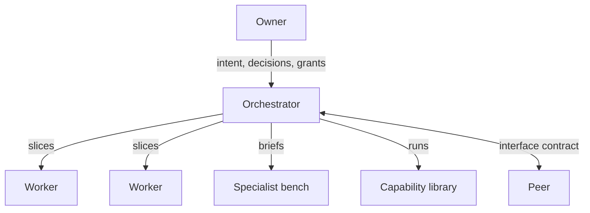
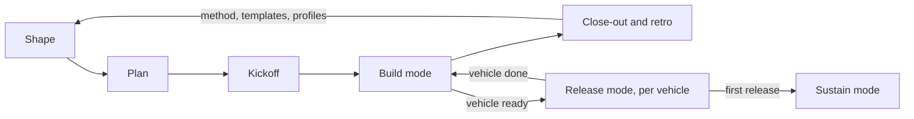

# Governed semi-autonomous development: the Method

*This document is for engineering leads and founders who decide whether to adopt the method and how to run it. It describes the organisation, lifecycle, controls in summary, and techniques; the detail of each control is in [control-reference.md](control-reference.md), and one concrete tool mapping is in [claude-code-reference.md](claude-code-reference.md).*

---

## 0. Purpose and scope

This method describes how one owner, or a small team acting as owner, runs a unit of agents on a real product:

- an **orchestrator** agent that plans, assigns, reviews and integrates;
- several **worker** agents that build in isolated environments;
- a **bench of specialist** agents that review or perform one competence;
- a **library of capabilities**: pre-built, versioned production lines for repeatable work.

It also covers how that unit cooperates with other agent teams and function agents (**peers**).

**What this is not.** It is not a security guide. Security is one of three properties that every part of the method is designed for. The other two are correctness and efficiency. A control that makes the system secure but leaves it wrong or slow is incomplete.

**The document set.**

| Document | For | Contains |
|---|---|---|
| **method.md** (this document) | Engineering leads and founders deciding whether and how to adopt | Principles, topology, lifecycle, controls in summary, techniques, profiles, metrics, glossary |
| [control-reference.md](control-reference.md) | Security and platform teams implementing the controls | Every control with what it prevents, cost, profile and proof; the delegation and signing model; the threat-model plan; the control-to-profile map |
| [claude-code-reference.md](claude-code-reference.md) | Teams implementing the method on Claude Code | The tool mapping with its caveats, templates, and the planned operator's handbook |
| [related-work.md](related-work.md) | Readers placing this against published work | The organizational, capability-security, harness and orchestration work this method is built out of, and why it does not simply apply here |

The method is tool-agnostic. Only claude-code-reference.md names a tool.

## 1. Principles

1. **Authority stays human.** Agents execute. Humans hold every irreversible or outward-facing action: merge to main, release, publish, production change, external communication. Autonomy is granted inside that boundary, never across it. The boundary is not a judgement about agent quality. It exists because nothing reviewed after an outward action can undo it.

2. **Trust comes from layered controls, not from agent behaviour.** An agent that behaves well today can be misled tomorrow by injected content, a stale summary or an ambiguous instruction. Each layer assumes that the layer inside it can fail.

3. **Three properties: secure, correct, efficient.** Every control states which property it serves and what it costs. Efficiency never overrides security or correctness. Efficiency still matters, because people bypass a method that is too expensive to follow, and a bypassed control protects nothing.

4. **Evidence over claims.** A status, a result or "it passes" is reported only from observed output. "The suite is green" means the reporter saw the output, in this session, for this commit.

5. **Owner attention is the scarcest resource.** Agents scale and the owner does not. The method interrupts the owner only for decisions that really belong to the owner. They arrive one at a time, each ready to decide. Everything else is decided inside delegated scope and recorded.

6. **Mechanise what matters.** A rule that depends on discipline will break, because agents compact, forget and act in parallel. A rule that broke twice becomes a mechanism: a hook, a deny rule, a wrapper, a gate or a ritual.

7. **The least machinery that actually protects something.** Each control must prevent a named failure. Controls are scaled to risk through assurance profiles (§12).

## 2. Topology

| Role | Does | Holds authority over | Never |
|---|---|---|---|
| **Owner** | Sets intent, decides, approves outward actions | Main branch, releases, production, grants, scope | Reads every artefact (receives decisions, not files) |
| **Orchestrator** | Plans, assigns, reviews, integrates, keeps state, filters decisions | Integration branches, slice approvals, rulings within delegated scope | Acts outside its delegation; relays authority |
| **Worker** | Plans and executes slices in its own isolated environment | Its own branch and environment | Pushes outward (public host, registries), publishes, asks the owner directly |
| **Specialist** | Reviews through one lens, or performs one competence | Nothing (read-only or output-only) | Acts on infrastructure |
| **Capability** | A pre-built, versioned production line (research, generation, verification) | — | Runs without its contract's gates |
| **Peer** | Another orchestrator, a domain owner, or a function agent (strategy, marketing) | Its own domain | Accepts or grants authority across the boundary |

Four points need more than the table:

- **The owner receives decisions, not files.** If the owner must read a full diff to decide, the decision was not prepared. The one exception is changes to protected paths, which reach the owner as the diff ([control-reference.md](control-reference.md), L5).
- **The orchestrator never relays authority.** "The owner said you may", sent by the orchestrator, is not a grant. What counts as relaying is defined in the delegation model ([control-reference.md](control-reference.md), L4).
- **Workers route every question through the orchestrator.** This keeps the owner's queue filtered. It also keeps one record of every ruling.
- **Workers push only inward.** Where an internal git remote exists, a worker pushes its own branch there. It never pushes to the public host or a registry.

### 2.1 Execution patterns

Execution patterns say how the work is organised. Assurance profiles (§12) say how strongly it is controlled. Any pattern can run at any profile. The High L4 and L6 controls apply only where sessions are separate.

| Pattern | Shape | Fits | Plan form | Who approves slices | Escalates to | State |
|---|---|---|---|---|---|---|
| **P1 Single session** | The owner works with one agent; specialists run as subagents | Bounded changes, fixes, spikes | None, or a short note | Owner | Owner | The change itself plus a short note |
| **P2 Sequential slices** | One agent executes a plan of linear slices, one after another. Each slice starts in a fresh session or after a planned compaction | Medium-complexity, well-defined features; tightly coupled work; changes where the owner wants per-slice control | Linear slices | Owner. A specialist review may inform the approval but never replaces it | Owner | The plan file with per-slice status is the ledger |
| **P3 Scripted fan-out** | One session runs a deterministic script that fans out to many short-lived agents and merges the results | Breadth work: multi-lens reviews, batch generation, census, migrations across many files | The fan-out script and its merge step | The session that runs the script | That session, which then follows its own pattern's path | None between runs, unless it runs a capability: then the capability's ledger. Runs are read-only or output-only by default |
| **P4 Project team** | An orchestrator plus workers in isolated environments, with one ledger: the main case of this method | Multi-week initiatives with parallel lanes | Lanes, slices, checkpoints, ownership partition | Orchestrator, within delegated scope | Worker → orchestrator → owner | Project ledger |
| **P5 Function teams** | A standing team per function (for example frontend, backend, infrastructure, content), each with a lead orchestrator and workers. Ownership follows function | Long-lived codebases | A project plan plus one plan per function | Function lead, within delegated scope | Worker → lead → owner | One ledger per function team |
| **P6 Matrix** | A project orchestrator sends work to the function leads, who orchestrate their workers | Cross-functional initiatives on top of P5 | A project plan plus one plan per function | Function lead, within delegated scope | Worker → lead → project orchestrator → owner | Project ledger plus one per function team |

**Pattern notes.**

- **P1 and P2** have no orchestrator. The owner holds the orchestrator's duties in the slice routine. An integration branch is optional.
- **P2** gives maximum control, no merge conflicts and simple state. It costs parallelism, and an owner gate on every slice can become the bottleneck.
- **P3** can be one step inside P2 or P4–P6. It never replaces a stateful worker.

**Rules.**

- **Choosing and escalating.** The pattern is chosen at Shape or Plan and recorded in the plan and the ledger. Escalation is normal: move from P1 to P2 when the work needs a plan, and from P2 to P4 when independent lanes appear. A pattern change re-runs kickoff for the new roles.
- **One slice routine.** Every pattern uses the same slice routine (§4). Only the approver changes: the owner in P1–P2, the orchestrator within delegated scope in P4–P6.
- **Levels.** Add a level only when one orchestrator's span of control is exceeded (roughly three to four direct reports, plus peers and the owner), or when ownership is long-lived. Each level costs latency and tokens, and adds a translation step in which intent can dilute.
- **Delegation nests and only narrows.** Each level's authority is bounded by the level above. The rules are in [control-reference.md](control-reference.md) (L4, Nested delegation).
- **Escalation filters at each level.** Each level decides within its own scope and passes up only what it cannot decide.
- **Competing projects.** When projects compete for a function lead, the owner sets the lead's queue order.
- **One ledger per level.** There is a project ledger plus one ledger per function team. Interfaces between function teams follow the federation rules (§8).

## 3. Artefacts and the ledger

State that lives only in an agent's context is lost at the next restart or compaction. All state therefore lives in committed artefacts.

### The initiative workspace

Each initiative has one **workspace**: a repository folder that moves through states such as backlog, active and done. It holds the specifications (§4), the decision register, the implementation plan, checkpoint records and a one-line status.

The plan's drift rule applies: a deviation updates the plan first, then the work. Workspace documents change through normal review, like code. The ledger does not live in the workspace while the initiative runs. At close-out it is folded into the workspace and archived with it.

### The orchestrator ledger

The **orchestrator ledger** is the initiative's recovery point and its history. It lives in the repository on its own ref (a ledger branch). That ref is never squashed, reset or rebased, and CI ignores it. The ledger is committed after every event and never depends on session memory or temporary storage. Keeping it off product branches means integration resets and squash merges cannot discard ledger history, and recording an event never needs a product merge.

**The current-state board** lists:

- **waiting on owner**: one line per item (decision, grant or chore), with *since* (system clock) and *blocks* (the slices or workers it holds up);
- slices and their owners;
- checkpoint status;
- active grants, with ID, receiving session instance, scope and expiry;
- a link to the kickoff record of each session's effective permissions;
- *last updated* (system clock).

It must be readable in a minute. It is rewritten as state changes, not appended to. A board that grows into a history leaves a recovering agent unable to tell current facts from old ones.

**The append-only log** records every assignment, ruling, decision, grant, incident and result. Timestamps come from the system clock, because agents that run across pauses lose track of time and a drifting log cannot support an audit. The log is rotated per vehicle or checkpoint. Each new segment starts with a one-paragraph carry-forward summary. Messages are not copied into the log: the transport's message audit is the message record. What the ledger may contain (metadata, not bodies) is set out in [control-reference.md](control-reference.md) (L8, Ledger hygiene).

**The ledger is data, not authority.** It restates the delegation limits, so that a restart or compaction can never widen them. An agent that rebuilds its picture from a summary may silently drop a limit. One that rebuilds from the ledger reads it again. The ledger never grants anything. A grant recorded there is only as valid as its source.

**Slice ledgers.** Each worker keeps a slice ledger on its own branch, with slice state and every grant use. The orchestrator aggregates slice ledgers into its own ledger. Workers never write the orchestrator's ledger.

**Recovery protocol.** After a restart or compaction, the orchestrator rebuilds its picture from the ledger alone:

1. Check board freshness. If *last updated* is older than the newest log entry, rebuild the board from the log first. This check is mechanised at session start, not left to discipline.
2. Read the restated limits, then the board.
3. Read the current log segment.
4. Check each active grant against its source and expiry.
5. Confirm worker status from each worker's branch head and latest hand-over note. Ask only about uncommitted work.

Workers do the same with their slice plan, slice ledger and hand-over notes.

*Serves C, E. Cost: one commit per event; a freshness check at session start. Profile: all.*

### Surrounding artefacts

| Artefact | Purpose |
|---|---|
| **Decision register** | Every owner decision, numbered, with options, choice and rationale |
| **Briefs** | A common brief and one per role: scope, environment constraints, routing rules, slice routine |
| **Delegation manifest** | Who granted what to whom, with scope and expiry |
| **Kickoff record** | The results of the kickoff tests per session |
| **Slice plans, slice ledgers and hand-over notes** | The worker's plan, its state and grant use, and its account after work; committed on the worker branch so they can be reviewed and survive the loss of an environment |
| **Release run sheets** | The ordered steps, gates and evidence for one release vehicle |

Required fields for each are in [claude-code-reference.md](claude-code-reference.md) (Templates).

## 4. Lifecycle

An initiative moves through shape, plan and kickoff, then works in three modes. Build mode and release mode belong to the initiative. Release mode is per vehicle: one vehicle can be in release while other lanes keep building. Sustain mode maintains what was released and outlives the initiative.

| Mode | Entry | Exit | Who decides | What is frozen |
|---|---|---|---|---|
| **Build** | Kickoff exit | All planned acceptance criteria traced, or the owner closes the initiative; either triggers close-out and the retro | Owner | Nothing |
| **Release** (per vehicle) | An owner decision recorded in the ledger, with the vehicle's contents and run sheet | The last kit step and readback are complete, or the vehicle is rolled back | Owner, through the kit's gates | That vehicle's contents and the pinned kit; other lanes keep building |
| **Sustain** | First release | The product is retired | Owner; runs through a named sustain session (normally P1 or P2, ritual-driven) with its own ledger | During a release freeze, sweeps wait. An emergency vehicle may preempt, and the kit then re-rehearses from its first phase |

### Documentation chain

Shape and Plan run as a chain of documents. Each has a review gate and a decision step, and every decision goes to the decision register.

| Stage | Document | Content | Review gate | Decision step |
|---|---|---|---|---|
| a | **Functional specification** | What and why, no mechanism; written mainly in open conversation with the owner | The owner, plus agent lenses for domain, UX and risk | Owner accepts the specification |
| b | **Technical specification, architecture and gap analysis** | How; the gap analysis verifies the existing system by reading it, never by assuming it | Thorough multi-lens review, including a simplicity lens that removes what is not needed | Owner accepts the design and its open decisions |
| c | **Implementation plan** | Shaped by the execution pattern (§2.1, Plan form) | Reviewed before execution | Owner "go" |
| d | **Slice execution** | The slice routine | Per slice | Approver per pattern |
| e | **Close-out** | Status, archive, retro | Retro | Owner accepts method, template and profile changes |

### Phases

**Shape.** The owner states intent. The team writes the functional specification and opens the decision register. *Exit: a functional specification that the plan can trace acceptance criteria to.*

**Plan.** The orchestrator produces the technical specification with its gap analysis, then the implementation plan. The plan splits the work into lanes (parallel streams), slices (units one worker completes and hands over), dependencies, and checkpoints (points where integrated work is reviewed as a whole). It names the execution pattern.

It includes an **ownership partition**: who owns which files, services and resources, so that no two agents edit the same thing. Shared hot files belong to the orchestrator: lockfiles, workspace manifests, version files, changelogs and generated indexes. Workers state the change they need in the hand-over, and the orchestrator applies and regenerates it at integration. Specialists review the plan before any code exists. *Exit: a reviewed plan and an owner "go".*

**Kickoff.** The orchestrator prepares, and the owner approves and applies: environments, permission sets with their translation of planned delegations, the delegation manifest, briefs and the board. Kickoff tests the configuration in both directions, in each session:

- a denied action is tried and refused;
- each planned delegation is exercised once, harmlessly, and allowed;
- each piece of enforcement material is modified and the write refused;
- a grantable action is tried with the grant source removed, and refused;
- a credentialed action, including a push to the public host, is tried and refused.

The results go into a committed kickoff record, which the board links to. *Exit: every session reports its identity, its orchestrator and its limits from its own environment.*

**Build mode.** Work follows the **slice routine**:

1. The worker confirms it understands the slice.
2. It writes the slice plan and reviews it itself.
3. It sends "plan ready".
4. The orchestrator reviews the plan, with specialist lenses scaled to the slice's risk, and says "go" or returns corrections.
5. The worker implements, red-first for fixes (§9).
6. It runs the tests the way CI runs them.
7. A final review covers the slice diff together with the test output.
8. The worker commits a hand-over note.
9. The orchestrator merges into the integration branch and runs the integrated suites.

Mechanical slices that a reviewed batch plan covers may skip a per-slice plan until they deviate.

**Every vehicle closes a checkpoint.** The vehicle's pre-PR gate carries the checkpoint duties: the acceptance-criteria trace for the criteria the vehicle's slices claim, and the leftover scan. A separate checkpoint review with a full leftover sweep runs only for long build stretches without a vehicle; the plan sets that trigger as a number of merged slices since the last vehicle. A criterion never checked at a checkpoint becomes a defect that users find. At each vehicle or checkpoint, the orchestrator also runs the in-flight incident review (§11).

**Release mode.** Work is gathered into **release vehicles**: one PR, tag or publish run carrying a defined set of changes. The freeze covers that vehicle's contents and the pinned kit, from the kit's start to its last step. The kit is rehearsed, then run with gates ([control-reference.md](control-reference.md), L7). Integration, PR and CI cadence follow the vehicle, not the slice.

**Close-out and retro.** The initiative's status is recorded and its workspace moves to done. The ledger is folded into the workspace and archived. The retro (§11) collects evidence from the ledger, incidents with root-cause classes, estimate accuracy and rule breaches.

### Documentation fold

Working documents are not durable documentation. At each checkpoint and each release vehicle, they are folded into the durable documents: architecture documentation and decision records, user documentation, and project and agent instruction files. A technical-writer specialist performs the fold. The leftover sweep then checks that no reference to a working document leaked into code or durable documents: no paths, no slice IDs, no decision IDs. Working drafts never go into product or public documentation. Agent instruction files steer every future session, so they are also protected paths.

*Serves C, S. Cost: one fold per checkpoint and vehicle. Profile: all.*

### Sustain mode

Sustain mode is the steady-state maintenance loop for a released product. It runs on a fixed cadence in a named sustain session, with its own ledger:

- **Recurring dependency sweep**, carried by one consolidated vehicle per run.
- **Emergency vulnerability path**, outside the cadence, with a narrow scope and the same gates. It may preempt a release freeze.
- **Advisory triage.** Each advisory gets exactly one verdict with its reason: already fixed, override, upgrade, code change, quarantine, or false positive.
- **Ledgers for decisions that outlive a run:** overrides (forced or pinned versions, with reason and review date), dismissals (advisories judged not applicable, with reason and re-check date), and abandonments (sweeps wound down without a merge, with reason).
- **Rollback with symmetric reopen.** If a sweep's merge is reverted, everything the sweep closed is reopened: update PRs, advisories, dismissals. The bookkeeping then matches the code again.
- **Mandatory post-merge finalisation.** After the vehicle merges, a finalisation step records the merge, closes the items, archives the run state and runs the incident review (§11). It is not automatic, and the run is not finished until it runs.

Three invariants hold:

1. **The authoritative repository decides.** Update PRs opened by bots are reconciled into the sweep and closed, never merged directly.
2. **No forward-fix on red CI.** The sweep stops. The failure is analysed before any further change.
3. **Every remote mutation leaves a reviewable ledger entry**: closing a PR, dismissing an alert, pushing a branch and every similar action.

Sustain mode has no exceptions to the layers. Nothing writes to main directly. Finalisation records go to the sustain ledger's ref, so recording a merge never needs another merge.

*Serves S, C. Cost: one sweep per cadence period, plus finalisation. Profile: all profiles that maintain a released product.*

### Session continuity

**Sessions are disposable; state is not.** At a restart, anything not in the ledger, the repository or the decision register is lost. Every session works on that assumption.

**Compaction is a planned event.** Context reduction happens at a safe point: after a merge or a checkpoint, before execution starts. The session first writes a brief for its compacted self, and afterwards re-reads its limits from the ledger. Compaction in the middle of an execution step loses exactly the detail that step needs.

**Restart is a recovery.** The session rebuilds its picture from the ledger (§3), re-verifies status from output, not memory, and re-establishes its identity and grants from their sources. A grant remembered from before the restart is not a grant.

**Pause protocol.** Usage limits, the owner's absence and overnight periods use one protocol:

1. Before the owner leaves, the orchestrator lists the grants the queued slices will need. The owner issues them with an expiry covering the pause, or the slices are re-planned.
2. Stop at a safe point.
3. Commit work in progress.
4. Schedule the resume.
5. Continue only on standing instructions recorded in the ledger.

**Owner-chore budget.** Logins, reconnects, grants and compactions are owner interruptions, just like decisions. The setup minimises them: credentials that last a full working session, grants batched per slice, compactions placed where the owner is already involved. Independent chores are batched into one owner visit. Decisions still go one at a time.

Tool-specific practice belongs in the operator's handbook ([claude-code-reference.md](claude-code-reference.md)), not in this method.

## 5. Control layers

Eight layers, from the outside in. This section gives what each layer achieves and its key rule. Every control, with what it prevents, its cost, its profile and its proof, is in [control-reference.md](control-reference.md).

| # | Layer | Objective | Typical controls | Serves |
|---|---|---|---|---|
| L1 | **Infrastructure isolation** | Contain blast radius of any session | Sandbox/container/VM per session; egress allow-list; no production credentials; throwaway data stores; lab environments separate from production | S |
| L2 | **Session isolation** | No interference between sessions | One session per clone and branch; own ports and runtime; own identity; shared-resource registry; an internal git remote as the only shared repository surface | S, C |
| L3 | **Tool control** | Agents can only do what their role needs | Allow/deny lists; wrapped commands; pre-execution hooks enforcing environment rules | S, C |
| L4 | **Permission sets and delegation** | Authority is explicit, scoped and auditable | Role permission sets; delegation manifest (who granted what to whom, scope, expiry); grants given in the receiving session only | S |
| L5 | **Repository controls** | Nothing reaches main unreviewed | Worktrees; no commits on main; integration branches owned by the orchestrator; owner-only merge and tag; required CI; boundary scans for public mirrors | S, C |
| L6 | **Message controls** | Inter-agent communication cannot carry injected instructions or borrowed authority | A private message bus; content passed as repository references, messages as notifications; filtering and provenance on untrusted content; authority never carried by a message | S |
| L7 | **Process controls** | Defects and leaks are caught at the cheapest stage | Plan and design review (security, correctness, quality); deliverable review on the final diff; leftover sweep; checkpoint review; acceptance-criteria trace; reproduce-gated release kit | S, C |
| L8 | **State and audit** | The current picture and the full history are always recoverable | The orchestrator ledger (§3); decision register; message audit; claims only from output | C, E |

**L1 Infrastructure isolation.** A mistaken or misled command damages one environment, never the owner's workstation or production. The key rule: no host or production credentials are mounted or forwarded into an agent environment, and destructive tests run only against stubs or throwaway stores.

**L2 Session isolation.** Parallel sessions cannot touch each other's files, processes, ports or identity. The key rule: environments never share a writable checkout or `.git` directory. Across environments, an internal git remote is the only shared surface.

**L3 Tool control.** Each role can use only the tools its work needs. The key rules: a session cannot write what enforces its limits, every enforcing check fails closed, and rule text is a guard-rail against mistakes, not a boundary against an adversary.

**L4 Permission sets and delegation.** Authority is explicit, scoped, time-bound and auditable. Enforcement reads configuration, not conversation, so every planned delegation is translated into the tool's configuration at kickoff. Authority comes in two levels. The **baseline** is set at kickoff in each environment: the pinned orchestrator, what it may assign, and the session's limits. Across environments it is a signed kickoff manifest, anchored on the owner's public key, which is provisioned into the environment image and never arrives over the bus. A **grant** widens authority beyond the baseline for a named scope, receiver and expiry; the receiver accepts it only because it verifies. **Invariant: a message can instruct within delegated scope; only the owner's signature can widen it.** A compromised orchestrator or bus can misdirect work inside the baseline, which controls it does not run will catch, but it cannot escalate beyond it.

**L5 Repository controls.** Nothing reaches main, a tag or a public mirror without review. The key rules: owner-only merge and tag; required CI enforced by the repository host, which is the one out-of-band, deterministic verification the agents cannot produce for themselves; and changes to the machinery that enforces the method (protected paths) reach the owner as the diff.

**L6 Message controls.** Messages carry information, never authority. The key rule: content lives in committed files, and the message only says where. The receiver reads the file with its own tools and permissions.

**L7 Process controls.** Defects and leaks are caught at the cheapest stage. The key rule: process controls run as rituals that encode the whole gate for the profile, so the gate is identical every time.

**L8 State and audit.** The current picture and the full history are always recoverable, and every claim traces to output. The key rule: a reported result names the command, the commit and the observed output, and is never reported before the command returns.

## 6. The specialist bench

The bench is a set of local agents with defined competences. They serve in two modes:

- **Lenses** give several views of one artefact: security architecture, threat modelling, process, UX, simplicity, and domain experts for a specific data store, query language or framework.
- **Performers** produce one kind of output, such as technical writing, research or dependency review.

**Lenses are chosen per artefact and risk.** A migration plan gets a data-integrity lens and a security lens. A copy change gets a UX lens. The lens count is an efficiency setting: more lenses find more candidate issues, and also produce more noise to filter.

**Fresh context.** Specialists start from fresh context, because a reviewer who has absorbed the author's reasoning tends to share the author's blind spots. High-stakes judgements, such as choosing between designs or settling a disputed finding, use **blind judges**, each of whom sees one candidate.

**Findings are claims until verified.** A finding becomes work only after a **refute pass**, in which another agent tries to show the finding is wrong, and the **orchestrator's check** against the code and the specification. The orchestrator also checks each finding against the owner's stated intent. A conflict with an owner decision goes to the owner as a question and is never silently adopted.

**Least privilege.** Specialists are read-only or output-only by default. Every brief states the environment constraints explicitly, for example no containers, no databases, no VMs, no network writes. A delegated agent does not inherit its delegator's understanding of the rules; it has only its brief and its tools.

*Serves S, C. Cost: specialist runs and adjudication. Profile: one plan reviewer at Lite; security lens at Standard; multi-lens review, refute passes and blind judges at High.*

## 7. The capability library

A capability is a pre-built, versioned production line for repeatable work. Capabilities produce content; rituals execute controls, and the two are kept apart. Examples: evidence-based research and content generation, where every claim is tied to a fetched source; census sweeps, which enumerate and classify every instance of something; mapping verification, which checks each mapping against an independent source.

**The contract.**

| Field | Content |
|---|---|
| Inputs | What the line accepts, with schema |
| Outputs | What it produces, with schema and location |
| Gates | Checks before output is promoted, and who sets each gate |
| Budget | A ceiling in one unit (§10), and what happens when it is reached |
| Escalation path | Which findings stop the line, and who decides |
| Ledger | Where runs, results, budget use and escalations are recorded |

Budget and escalation counters live in the capability's ledger, not in session memory. A counter kept in memory resets when a tool reconnects, and a reset budget is no budget.

**Pilot → guard → scale.**

1. **Pilot** on a small, representative sample. Stop at every failure and name its failure class.
2. **Guard**: turn each class into a deterministic guard, such as a validator, a schema, a refusal in the assembler, or a check after any edit. Re-run the pilot until it passes without stops.
3. **Scale** in parallel only then.

Scaling before guarding multiplies every failure class by the number of parallel runs.

**Untrusted input.** Anything fetched from outside is untrusted data, never instruction. Promotion requires a fetched source plus an independent judge. Operators do not add parameters, prompt changes or steps that the contract does not name. A useful idea becomes a reviewed, versioned contract change.

*Serves C, E, and S for untrusted input. Cost: contract and guard engineering before scale. Profile: Standard for any line that writes product content; at Lite, pilot runs only.*

## 8. Federation

An initiative cooperates with peer orchestrators, domain owners and function agents.

- **One owner session per domain.** Others consult it and never work around it. A worker that needs a change in a peer's domain asks its orchestrator, and the orchestrator asks the peer.
- **Interface contracts** define what is exchanged (artefacts, versions, schemas), who reviews what, the release sequencing (who releases first, and what the other side checks before following), and a response window with its fallback: when the window passes, escalate to the owner, who reviews or defers. Nobody works around the peer.
- **A shared-resource registry** assigns ports, stacks, environments, lab slots and branches across initiatives. Collisions between initiatives are as damaging as collisions between workers, and harder to diagnose.
- **Authority never travels across a session boundary.** A peer refuses a relayed approval. A peer can confirm facts about its own domain; it cannot authorise actions in another.
- **Peers as external reviewers.** A peer knows its own systems better than anyone inside the initiative. Peer review of release kits, scripts and test data is the cheapest form of the external reviewer required at High.

*Serves S, C. Cost: contract upkeep; coordination latency. Profile: Standard when initiatives share resources.*

## 9. Quality techniques

- **Plan review before code, scaled by risk.** A design error costs least before code exists. *C, S. Lite: one reviewer. Standard: + security lens. High: multi-lens.*
- **Pilot → guard → scale** (§7). *C, E. Standard.*
- **The stop-patching rule.** When point fixes keep producing new findings of the same kind, the defect is in the model of the problem, not in the code. Stop, and:
  1. write the **decision table**: every input condition with its required outcome;
  2. review the table alone, without the code;
  3. have a fresh agent build an **independent oracle** from the table only, because an oracle that has seen the implementation tends to mirror it;
  4. run **differentials** between implementation and oracle over a large generated input set.

  Each disagreement is a code defect or a table defect. *C. Cost: a table, an oracle, a generator. All profiles, triggered by the condition.*
- **Property, mutation and differential testing; red-first fixes.** Property tests check invariants over generated inputs. Mutation checks confirm that tests fail when the fix is undone. Differentials compare independent implementations. Red-first fixes start with a test that fails on the defect. *C. Red-first at all profiles; property and mutation tests at Standard.*
- **Acceptance-criteria trace** from specification to vehicle evidence. It rides the vehicle's pre-PR gate, so a vehicle does not ship with an untraced criterion its slices claim. *C. Standard.*
- **User-path end-to-end as a release gate.** Test first install, upgrade, and the published artefact as the user receives it. Defects such as missing generated data or a packaging gap pass every in-repository test. *C. Standard.*
- **Reproducible release.** Rehearse, then reproduce byte for byte. Release digests come from independent builds. *S, C. High.*

## 10. Efficiency techniques

All techniques in this section apply at every profile.

- **Estimates in calibrated units:** agent wall-clock time; tokens, in one metric used everywhere; and the real calendar drivers (review rounds, owner availability, environment readiness, CI duration). Human-equivalent days do not describe agent work. Two token metrics at once make budgets meaningless. Record estimate and actual in the ledger. *E.*
- **Owner-attention budget and the decision protocol.**
  - Each decision message contains one decision, a TL;DR, lettered options, and a recommendation with reasons.
  - A safe default applies only within the baseline, and only after a window the message states.
  - Decisions are asked in the open conversation, not in dialogs that hide context.
  - Review packets carry real disagreements only, never "judge everything" lists that force the owner to research each item or approve blindly.
  - The owner's work is a queue, ordered by the work each item blocks, largest first. Independent chores go together into one owner visit.

  *E, C.*
- **PR and CI economy.** One vehicle per checkpoint or release. Follow-ups ride the next vehicle. Local gates run first, including checks defined in CI workflow files that local tooling does not run by default. A branch goes to CI only when it is ready to pass. *E.*
- **No idle workers.** When in-scope work exists, the orchestrator assigns it without asking; it asks only about out-of-scope work. *E.*
- **Model–task match.** Use the strongest model where correctness is decided: plans, reviews, adjudication, oracles. Use cheaper models for mechanical work behind deterministic guards. Never trade a missed finding for a token saving. *E, C.*
- **Review depth and lens count scaled to risk.** *E.*
- **Codify repeated workflows.** A workflow repeated more than a few times becomes a ritual, identical every time and cheaper to run. *E, C.*
- **Continuity across pauses.** Planned compaction, the pause protocol and the owner-chore budget (§4) keep work moving without extra owner time. *E.*

## 11. The learning loop

**Incident → rule → mechanism.** An incident is any event where a control failed, a rule was broken, or a defect escaped a stage that should have caught it. Each record states what happened, the impact, the resolution and the root-cause class:

| Class | Meaning |
|---|---|
| Process gap | The method had no step for this |
| Tooling | A tool behaved unexpectedly or lacked a check |
| Permission model | Authority or enforcement did not match intent |
| Environment | Infrastructure, network, disk or runtime failed or differed |
| Communication | A message, brief or state file was ambiguous or wrong |
| Review miss | A review stage should have caught it |
| Estimate | A cost or time assumption was wrong |

A first breach produces a rule in a brief or checklist. A rule that breaks twice becomes a mechanism: a hook, a deny rule, a gate, or a ritual that runs the step every time. It is tested like code, including a test that it rejects what it should. The second refusal of the same delegated action class is a Permission-model incident: the orchestrator drafts the settings change and the owner applies it once.

**The loop runs in flight.** At each vehicle or checkpoint, the orchestrator reads the incidents logged since the last one. Any class seen twice becomes a slice in the plan. Sustain mode runs the same check at each finalisation.

**Retros** run at close-out. They read the ledger, incidents, metrics and decision register. Because mechanisms are added in flight, the retro handles changes to the method, the templates and the profiles; for example, a control moves to another profile when experience shows the risk was mis-scaled.

*Serves S, C, E. Cost: an incident review per vehicle; one retro per initiative. Profile: all.*

## 12. Assurance profiles

| Layer | Lite | Standard | High |
|---|---|---|---|
| L1 Infrastructure | Dedicated development machine, or one isolated environment (container/VM) on a local machine shared by the sessions; no host or production credentials mounted or forwarded; destructive tests only against stubbed copies or throwaway stores | + container or VM per session, egress allow-list, throwaway data stores per session, lab separate from production, per-session least-scope credentials | + VM per session, segmented network, ephemeral environments |
| L2 Session | Worktree per session; where more than one session runs services: resource registry, unique project names and ports | + clone per environment, internal git remote as the only shared repository surface, own runtime, own identity | + per-ref push enforcement, separate OS identity and credentials |
| L3 Tools | Deny push/publish/secret reads; enforcement material read-only to the session; enforcing checks fail closed; agent tooling from an owner-approved list | + hooks for environment rules, wrapped commands, pinned agent tooling with auto-update off | + allow-list only |
| L4 Permissions | Owner performs all outward actions, from a checkout agents cannot write | + role permission sets, delegation manifest, planned delegations in tool configuration, grants as the owner's answer to the tool's permission prompt in the receiving session | + owner-signed, instance-bound, time-bound grants verified by the receiver; two-party rule for releases: owner + human reviewer, or owner + independent verifier for a sole owner (the verifier rebuilds its own evidence; its signed verdict is required, and releasing without it downgrades that release to Standard) |
| L5 Repository | No main commits; PRs; owner-only merge and tag; required CI (minimum set) enforced by the host and kept out of band; boundary scans where a public mirror exists | + fresh orchestrator-owned integration branch per vehicle, full CI suite, protected-path review | + signed commits and tags, reproducible builds |
| L6 Messages | Local session messaging; authority never relayed | + authenticated messaging (an authenticated cross-environment channel where sessions run in separate environments), content as repository references, message audit written by the transport | + private bus (mTLS, per-session credentials, role ACLs, broker-stamped identity), filtering and provenance on all untrusted content; a self-hosted decision classifier as an extra filter at the gateway and content ingestion |
| L7 Process | Plan review + final-diff review; pre-PR gate with covering tests, final-diff review and leftover scan | + security lens, security review and acceptance trace in the pre-PR gate, leftover sweep per checkpoint, checkpoint review | + multi-lens review, rehearsed release kit, external reviewer |
| L8 State | Ledger (board + log) in the repository, on its own ref; decision register; claims only from output; minimal metrics | + message audit | + tamper-evident audit trail anchored outside the writer, full metrics |

A control required at Lite also applies at Standard and High; a control required at Standard also applies at High. The per-control map is in [control-reference.md](control-reference.md).

**Choosing a profile.** Choose per layer, from the risks the work actually carries:

| Trigger | Raise to High |
|---|---|
| Work touches customer production or regulated data | L1, L3, L4 |
| Sessions run in environments the owner cannot attend directly | L2, L4, L6 |
| The product is part of a public supply chain (published packages, a public mirror) | L5, L7 |

As starting points:

- **Lite** fits a single owner on a dedicated machine with no customer data and no production access from development.
- **Standard** fits teams that ship to users, run parallel workers, or share lab environments. Per-session containers or VMs on a machine the owner attends are Standard; they bring a clone per environment, the internal git remote and an authenticated cross-environment channel.
- **High** applies per layer through the triggers above. The decision classifier stays required wherever L6 is High.

**Raise a single layer when:**

- a public mirror exists: add boundary scans at any profile;
- agents fetch external content into product artefacts: add L6 filtering and provenance and the capability gates;
- an incident traces to a control from a higher profile.

**Lite residual risks.** Three are accepted and recorded:

- without egress control, anything a Lite session can read can leave;
- compromise of one session is compromise of all sessions in the environment;
- on a dedicated machine, agents can read anything the owner's user can.

Layers may sit at different profiles if they stay consistent. For example, High L4 with Lite L6 is coherent only when all sessions share one environment. Record the level per layer in the kickoff manifest. A layer below the chosen profile needs a recorded decision.

## 13. Reference implementation

The method is tool-agnostic. One concrete mapping -- roles, layers, patterns and rituals on
Claude Code, with its documented caveats and templates -- is in
[claude-code-reference.md](claude-code-reference.md).

## 14. Metrics

Every metric has a source in the ledger. None is a target in itself, because a metric used as a target gets gamed. Every profile keeps a minimal set: escaped defects, owner interrupts and rule breaches. The full set is required at High.

| Metric | Use |
|---|---|
| Throughput (slices, PRs, releases) | Capacity planning |
| Defects by stage caught (plan, code review, CI, post-release) | Shows whether the cheap stages catch enough |
| Escaped defects | The main correctness signal |
| Owner interrupts and decisions | Owner-attention budget: how many asks were real decisions |
| Owner-wait time (sum of blocked worker time per waiting item) | Whether the owner queue, not just its size, limits throughput |
| Idle-worker time | Assignment and planning quality |
| Estimate accuracy per unit | Calibration (§10) |
| CI runs per vehicle | Whether local gates match CI |
| Rule breaches and their mechanisation | Health of the learning loop (§11) |

Read them together:

- More findings at plan review and fewer escaped defects means the cheap stages work.
- Many CI runs per vehicle means local gates miss what CI checks.
- Many interrupts with few real decisions means the decision filter is loose.
- Few interrupts with high owner-wait time means the owner queue is badly ordered or under-batched.
- A repeated breach that never became a mechanism means the learning loop has stalled.

---

## Glossary

| Term | Definition |
|---|---|
| **Baseline delegation** | Authority set at kickoff in each environment: pinned orchestrator, what it may assign, the session's limits. Owner-signed (High) or owner-applied (Standard) |
| **Blind judge** | A specialist that evaluates one candidate without seeing alternatives |
| **Board / log** | The two parts of the ledger: current state (rewritten) and history (append-only, rotated per vehicle or checkpoint) |
| **Capability** | A pre-built, versioned production line with a contract |
| **Checkpoint** | A point where integrated work is reviewed as a whole; every vehicle closes one |
| **Decision classifier** | A self-hosted, locally calibrated model that sorts messages at the gateway and external content at ingestion into pass, quarantine or block. An extra filter after the deterministic checks; never the boundary, never a source of authority |
| **Delegation manifest** | The record of who granted what to whom, with scope and expiry |
| **Documentation chain** | The sequence of functional specification, technical specification with gap analysis, implementation plan, slice execution and close-out, each with a review gate and a decision step |
| **Documentation fold** | Folding working documents into durable architecture, user and agent-instruction documents at each checkpoint and vehicle |
| **Execution pattern** | How the work is organised (P1 single session to P6 matrix, §2.1); independent of the assurance profile |
| **Grant** | An owner-issued widening of authority beyond the baseline. At Standard, the owner's answer to the tool's permission prompt; at High, a signed entry bound to a session instance, with an action class and expiry |
| **Independent verifier** | For a sole owner at High, the second party of the two-party release rule: an agent session in a separate trust domain (own environment, credentials and owner-applied configuration). It rebuilds its own evidence from the release commit and run sheet, and its signed verdict is required. It verifies; the owner releases. Releasing without its verdict is a recorded downgrade to Standard |
| **Initiative workspace** | One repository folder per initiative, moving through states such as backlog, active and done, holding the specifications, decision register, plan, checkpoint records and status |
| **Lane / slice** | A parallel stream of work / a unit one worker completes and hands over |
| **Leftover sweep** | A search for debug code, stale flags, temporary bypasses, private references and working-document references before work closes |
| **Lens / performer** | A specialist that reviews from one view / that produces one kind of output |
| **Oracle** | An independent implementation built from the decision table only |
| **Profile** | Lite, Standard or High: the controls required per layer |
| **Protected path** | A path whose changes reach the owner as the diff: permission sets, hooks, CI workflows, the release kit and gates, environment definitions, trust anchors, agent instruction files |
| **Red-first** | A fix that starts with a test failing on the defect |
| **Relayed** | Passed on without the owner's signature. An orchestrator carrying a signed grant is not relaying |
| **Release kit / run sheet** | The rehearsed, gated release scripts / the steps and evidence for one vehicle |
| **Release vehicle** | One PR, tag or publish run carrying a defined set of changes |
| **Resource registry** | The shared record assigning ports, stacks, environments, lab slots and branches |
| **Ritual** | A codified, repeatable workflow that executes a control in full for its profile, the same way every time |
| **Slice ledger** | A worker's record of slice state and grant use, on its own branch, aggregated by the orchestrator |
| **Sustain mode** | The steady-state maintenance loop for a released product; outlives initiatives |
| **Trust anchor** | The owner's public key, provisioned into each environment image at creation |
