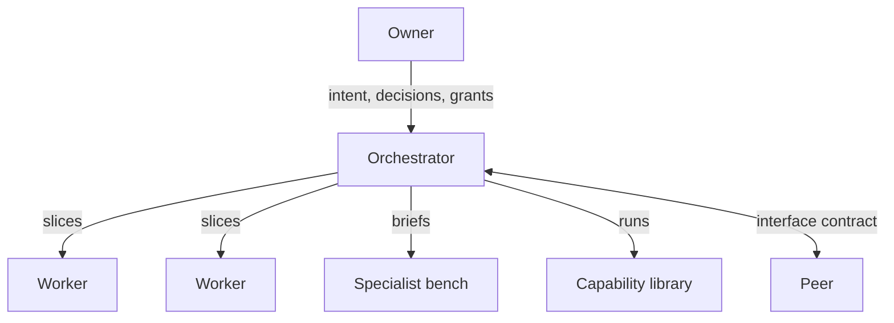
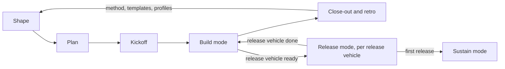

# Governed semi-autonomous development: the Method

*This document is for engineering leads and founders who decide whether to adopt the method and how to run it. It states what the method requires and why: the organisation, the lifecycle in outline, the controls in summary, and the techniques as rules. The procedures are in [practice.md](practice.md), the terms in [glossary.md](glossary.md), the detail of each control in [control-reference.md](control-reference.md), and one concrete tool mapping in [claude-code-reference.md](claude-code-reference.md).*

---

## 0. Purpose and scope

This method describes how one owner, or a small team acting as owner, runs a unit of agents on a real product:

- an **orchestrator** agent that plans, assigns, reviews and integrates;
- several **worker** agents, each building on its own branch, in a worktree or clone inside an isolated environment;
- a **bench of specialist** agents that review or perform one competence;
- a **library of capabilities**: pre-built, versioned production lines for repeatable work.

It also covers how that unit cooperates with other agent teams and function agents (**peers**).

**What this is not.** It is not a security guide. Security is one of three properties that every part of the method is designed for. The other two are correctness and efficiency. A control that makes the system secure but leaves it wrong or slow is incomplete.

**Agents inside the product.** Governing agents that run inside the product itself, acting on its business logic at runtime, is out of scope. This method governs the agents that build the product.

**Data sent to the model provider.** Everything a session reads is sent to the model provider: source code, fixtures, logs, and any data in a lab or test store. Which data agents may read, and the provider's terms for it, are the adopter's decision and outside this method. The regulated-data trigger (§12) assumes that decision has been made.

**The document set.**

| Document | For | Contains |
|---|---|---|
| **method.md** (this document) | Engineering leads and founders deciding whether and how to adopt | Principles, topology, artefacts, lifecycle, controls in summary, techniques, profiles, metrics |
| [practice.md](practice.md) | Whoever runs a team: an orchestrator, an owner, or tooling that launches teams | The procedures that run the method |
| [glossary.md](glossary.md) | Every reader | The terms used across the documents, in alphabetical order |
| [control-reference.md](control-reference.md) | Security and platform teams implementing the controls | Every control with what it prevents, what keeps it, cost, profile and proof; delegation and signing; the threat-model plan; the control-to-profile map |
| [claude-code-reference.md](claude-code-reference.md) | Teams implementing the method on Claude Code | The tool mapping with its caveats, templates, and the planned operator's handbook |
| [related-work.md](related-work.md) | Readers placing this against published work | The published work this method is built out of, and where the setting differs |
| [standards-map.md](standards-map.md) | Security leaders and auditors who report against a framework | Which method controls relate to each item of MITRE ATLAS, the OWASP agentic Top 10 and NIST SSDF, and the gaps; placement, not a compliance claim |

The method is tool-agnostic. Only claude-code-reference.md names a tool.

## 1. Principles

1. **Authority stays human.** Agents execute. Humans hold every irreversible or outward-facing action: merge to main, release, publish, production change, external communication. Autonomy is granted inside that boundary, never across it. The boundary is not a judgement about agent quality. It exists because nothing reviewed after an outward action can undo it.

2. **Trust comes from layered controls, not from agent behaviour.** An agent that behaves well today can be misled tomorrow by injected content, a stale summary or an ambiguous instruction. Each layer assumes that the layer inside it can fail.

3. **Three properties: secure, correct, efficient.** Every control states which property it serves and what it costs. Efficiency never overrides security or correctness. Efficiency still matters, because people bypass a method that is too expensive to follow, and a bypassed control protects nothing.

4. **Evidence over claims.** A status, a result or "it passes" is reported only from observed output. "The suite is green" means the reporter saw the output, in this session, for this commit.

5. **Owner attention is the scarcest resource.** Agents scale and the owner does not. The method interrupts the owner only for decisions that really belong to the owner. They arrive one at a time, each ready to decide. Everything else is decided inside delegated scope and recorded.

6. **Mechanise what matters.** A rule that depends on discipline will break, because agents compact, forget and act in parallel. A rule that broke twice becomes a mechanism: a hook, a deny rule, a wrapper, a gate or a ritual.

7. **Agents forget: design for it.** Sessions lose context and policy memory at unpredictable intervals: at compaction, at restart, and through a summary that drops a detail. Limits, state and decisions therefore live in durable artefacts. A session re-reads them from there and re-checks them, and never relies on what it remembers.

8. **The least machinery that actually protects something.** Each control must prevent a named failure. Controls are scaled to risk through assurance profiles (§12).

## 2. Topology

| Role | Does | Holds authority over | Never |
|---|---|---|---|
| **Owner** | Sets intent, decides, approves outward actions | Main branch, releases, production, environments, grants, scope | Reads every artefact (receives decisions, not files) |
| **Orchestrator** | Plans, assigns, reviews, integrates, keeps state, filters decisions | Integration branches, slice approvals, rulings within delegated scope | Acts outside its delegation; relays authority; holds environment authority; from Standard, executes product code or fetches external content in its own environment |
| **Worker** | Plans and executes slices on its own branch, in its own worktree inside an isolated environment (shared with workers of equal authority where the profile allows). Each slice runs at the tier the plan gives it | Its own branch and worktree or clone | Pushes outward (public host, registries), publishes, asks the owner directly; takes an action that needs environment authority without being assigned it |
| **Specialist** | Reviews through one lens, or performs one competence | Nothing (read-only or output-only) | Acts on infrastructure |
| **Capability** | A pre-built, versioned production line (research, generation, verification) | — | Runs without its contract's gates |
| **Peer** | Another orchestrator, a domain owner, or a function agent (strategy, marketing) | Its own domain | Accepts or grants authority across the boundary |

Four points need more than the table:

- **The owner receives decisions, not files.** If the owner must read a full diff to decide, the decision was not prepared. There are two exceptions. Changes to protected paths reach the owner as the diff ([control-reference.md](control-reference.md), L5). At High L7, a human reads the diff of every high-risk slice ([control-reference.md](control-reference.md), L7).
- **The orchestrator never relays authority.** "The owner said you may", sent by the orchestrator, is not a grant. What counts as relaying is defined in the delegation model ([control-reference.md](control-reference.md), L4).
- **Workers route every question through the orchestrator.** This keeps the owner's queue filtered. It also keeps one record of every ruling.
- **Slices run at different tiers.** A tier is a configuration: the model and, where the tool has one, its reasoning setting. It is set per slice (§10) and never changes permissions: authority comes from the role, not from the model.

### 2.1 Execution patterns

Execution patterns say how the work is organised. Assurance profiles (§12) say how strongly it is controlled. Any pattern can run at any profile. The High L6 bus, and the parts of High L4 that cross environments (the signed kickoff manifest), apply only where sessions run in separate environments.

| Pattern | Shape | Fits | Plan form | Who approves slices | Escalates to | State |
|---|---|---|---|---|---|---|
| **P1 Single session** | The owner works with one agent; specialists run as subagents or separate sessions | Bounded changes, fixes, spikes | None, or a short note | Owner | Owner | The change plus a short note on the ledger ref |
| **P2 Sequential slices** | One agent executes a plan of linear slices, one after another. Each slice starts in a fresh session or after a planned compaction | Well-defined features of medium complexity; tightly coupled work; per-slice owner control | Linear slices | Owner. A specialist review may inform the approval but never replaces it | Owner | The plan file with per-slice status, on the ledger ref, is the ledger |
| **P3 Scripted fan-out** | One session runs a deterministic script that fans out to many short-lived agents and merges the results | Breadth work: multi-lens reviews, batch generation, census, migrations across many files | The fan-out script and its merge step | The session that runs the script | That session, which then follows its own pattern's path | None between runs, or the ledger of the capability it runs. Read-only or output-only by default |
| **P4 Project team** | An orchestrator plus workers in isolated environments, with one ledger: the main case of this method. Each worker writes only on its own branch, within its ownership; the orchestrator alone integrates | Multi-week initiatives whose work splits into independent lanes | Lanes, slices, checkpoints, ownership partition | Orchestrator, within delegated scope | Worker → orchestrator → owner | Project ledger |
| **P5 Function teams** | A standing team per function (for example frontend, backend, infrastructure, content), each with a lead orchestrator and workers. Ownership follows function | Long-lived codebases | A project plan plus one plan per function | Function lead, within delegated scope | Worker → lead → owner | One ledger per function team |
| **P6 Matrix** | A project orchestrator sends work to the function leads, who orchestrate their workers | Cross-functional initiatives on top of P5 | A project plan plus one plan per function | Function lead, within delegated scope | Worker → lead → project orchestrator → owner | Project ledger plus one per function team |

**Pattern notes.**

- **P1 and P2** have no orchestrator. The owner holds its approval duties: plan approval, rulings and the merge. The agent session keeps the ledger, and the integrated suites run in CI (at Lite, CI or a worker-authority environment). An integration branch is optional.
- **P2** gives maximum control, no merge conflicts and simple state. It costs parallelism, and an owner gate on every slice can become the bottleneck.
- **P3** can be one step inside P1, P2 or P4–P6. It never replaces a stateful worker. A P3 run that writes is idempotent and commits per batch to its branch, so an interrupted run can resume.
- **P4** runs workers in parallel but integrates serially, one merge at a time. What this does not prevent is clashing assumptions: two slices can each be right alone and wrong together. Slice plans and hand-over notes therefore record the assumptions and decisions taken, including every assumption about anything outside the worker's ownership partition: interfaces, shared data, contracts. A worker cannot see other slices, so the orchestrator judges which assumptions touch them, at plan review ([practice.md](practice.md), §3, step 4).

**Rules.**

- **Choosing by how the work decomposes.** The deciding property is not size but coupling. Tightly coupled or sequential work stays with one agent (P1, P2): there, coordination costs more than it returns, in tokens, in hand-offs and in errors that compound from agent to agent. Multi-agent patterns are for work that splits into parts that are independent in substance, not only in files. Tool load counts too: coordination cost rises with the number of tools each agent carries.
- **Choosing and escalating.** The pattern is chosen at Shape or Plan and recorded in the plan and the ledger. Escalation is normal: move from P1 to P2 when the work needs a plan, and from P2 to P4 when independent lanes appear. A pattern change re-runs kickoff for the new roles. An escalation from P2 to P4 also re-runs plan review, because P4 needs an ownership partition.
- **Patterns compose.** A plan may assign a pattern per **plan segment**: for example P2 for a serial core, and P4 for the lanes that split from it. Each segment records its pattern. A segment's pattern sets only its shape, serial or parallel. The approver, the ledger, the escalation path and the integration branch the work starts from come from the plan's highest pattern, for the whole plan. Segment boundaries are checkpoints.
- **One slice routine.** Every pattern uses the same slice routine ([practice.md](practice.md), §3). Only the approver changes: the owner in P1–P2, the orchestrator within delegated scope in P4–P6, and in a composed plan the approver of its highest pattern.
- **Levels.** Add a level only when one orchestrator's span of control is exceeded (roughly three to four direct reports, plus peers and the owner), or when ownership is long-lived. Each level costs latency and tokens, and adds a translation step in which intent can dilute.
- **Delegation nests and only narrows.** Each level's authority is bounded by the level above. The rules are in [control-reference.md](control-reference.md) (L4, Nested delegation).
- **Escalation filters at each level.** Each level decides within its own scope and passes up only what it cannot decide.
- **Competing projects.** When projects compete for a function lead, the owner sets the lead's queue order.
- **One ledger per level.** There is a project ledger plus one ledger per function team. Interfaces between function teams follow the federation rules (§8).

## 3. Artefacts and the ledger

Principle 7 puts all state in committed artefacts. This section names them.

### The initiative workspace

Each initiative has one **workspace**: a repository folder that moves through states such as backlog, active and done. It holds the specifications, the decision register, the implementation plan, checkpoint records and a one-line status.

The plan's drift rule applies: a deviation updates the plan first, then the work. Workspace documents change through normal review, like code. The ledger does not live in the workspace while the initiative runs. At close-out it is folded into the workspace and archived with it.

### The orchestrator ledger

The **orchestrator ledger** is the initiative's recovery point and its history. It lives in the repository on its own ref (a ledger branch). That ref is never squashed, reset or rebased, and CI ignores it. The ledger is committed after every event and never depends on session memory or temporary storage. Keeping it off product branches means integration resets and squash merges cannot discard ledger history, and recording an event never needs a product merge.

**The current-state board** lists what waits on the owner (each decision, grant or chore with *since* and the work it *blocks*), slices with owner, complexity-and-risk class and tier, workers with their declared configuration, checkpoint status, active grants, open exceptions with review dates, a link to the kickoff record, and *last updated* (system clock). Its fields are in the board template ([claude-code-reference.md](claude-code-reference.md), Templates).

It must be readable in a minute. It is rewritten as state changes, not appended to. A board that grows into a history leaves a recovering agent unable to tell current facts from old ones.

**The append-only log** records every assignment, ruling, decision, grant, incident and result. Timestamps come from the system clock, because agents that run across pauses lose track of time and a drifting log cannot support an audit. The log is rotated per vehicle or checkpoint. Each new log segment starts with a one-paragraph carry-forward summary. Messages are not copied into the log: the transport's message audit is the message record. What the ledger may contain (metadata, not bodies) is set out in [control-reference.md](control-reference.md) (L8, Ledger hygiene).

**The ledger is data, not authority.** It restates the delegation limits, so that a lossy summary can never widen them. An agent that rebuilds its picture from a summary may silently drop a limit. One that rebuilds from the ledger reads it again. After a restart or compaction, every session therefore rebuilds from the ledger alone ([practice.md](practice.md), §7, Recovery protocol). The ledger never grants anything. A grant recorded there is only as valid as its source.

**Slice ledgers.** Each worker keeps a slice ledger on its own branch, with slice state and every grant use. The orchestrator aggregates slice ledgers into its own ledger. Workers never write the orchestrator's ledger.

*Serves C, E. Cost: one commit per event. Profile: all.*

### Surrounding artefacts

| Artefact | Purpose |
|---|---|
| **Decision register** | Every owner decision, numbered, with options, choice and rationale |
| **Briefs** | A common brief and one per role: scope, environment constraints, routing rules, slice routine |
| **Delegation manifest** | Who granted what to whom, with scope and expiry |
| **Kickoff record** | The results of the kickoff tests and re-checks per session |
| **Slice plans, slice ledgers and hand-over notes** | The worker's plan, its state and grant use, and its account after work, including the assumptions and decisions taken; committed on the worker branch so they can be reviewed and survive the loss of an environment |
| **Release run sheets** | The ordered steps, gates and evidence for one release vehicle |

Required fields for each are in [claude-code-reference.md](claude-code-reference.md) (Templates).

## 4. Lifecycle

An initiative moves through shape, plan and kickoff, then works in three modes. Build mode and release mode belong to the initiative. Work reaches main in **merge vehicles** (a PR to main) and reaches users in **release vehicles** (a tag or publish run). Only a release vehicle enters release mode. Sustain mode maintains what was released and outlives the initiative.

| Mode | Entry | Exit | Who decides | What is frozen |
|---|---|---|---|---|
| **Build** | Kickoff exit | All planned acceptance criteria traced (at Lite, checked in the final-diff review), or the owner closes the initiative; either triggers close-out and the retro | Owner | Nothing |
| **Release** (per release vehicle) | An owner decision recorded in the ledger, with the release vehicle's contents and run sheet | The release is published and read back, or the vehicle is rolled back | Owner; at High, through the kit's gates | That vehicle's contents (at High, also the pinned kit); other lanes keep building |
| **Sustain** | First release vehicle | The product is retired | Owner; runs through a named sustain session (normally P1 or P2, ritual-driven) with its own ledger | During a release freeze, sweeps wait. An emergency vehicle may preempt; at High, the kit then re-rehearses from its first phase |

**Shape.** The owner states intent. The team writes the functional specification and opens the decision register. Shape and Plan run as a documentation chain, in which every document has a review gate and a decision step ([practice.md](practice.md), §1). *Exit: a functional specification that the plan can trace acceptance criteria to.*

**Plan.** The orchestrator produces the technical specification with its gap analysis, then the implementation plan. The plan splits the work into lanes, slices, dependencies and checkpoints, names the execution pattern, and tags each slice with a **complexity-and-risk class**, which decides the tier the slice runs at (§10) and whether the slice is high-risk. It lists each lane's environment needs, including any **environment authority**, so kickoff builds them once. It includes an **ownership partition**, so that no two agents edit the same thing. Shared hot files belong to the orchestrator: workers state the change they need in the hand-over, and the orchestrator decides and integrates it. The regeneration executes dependency code, so from Standard it runs in CI; at Lite it may run in a worker-authority environment ([practice.md](practice.md), §3). Specialists review the plan before any code exists, because a design error costs least then. *Exit: a reviewed plan and an owner "go".*

**Kickoff.** The orchestrator (in P1 and P2, the agent session) prepares, and the owner approves and applies: environments, permission sets with their translation of planned delegations, the delegation manifest, briefs and the board. Kickoff tests enforcement in both directions, because a limit that was never tried may not hold and a delegation that was never exercised may be refused. Mechanised re-checks keep enforcement tested after kickoff ([practice.md](practice.md), §2). *Exit: every session reports its identity, its orchestrator and its limits from its own environment.*

**Build mode.** Every slice follows the slice routine: plan, approval, implementation, tests as CI runs them, final review and hand-over ([practice.md](practice.md), §3). Every merge vehicle closes a checkpoint, so integrated work is reviewed as a whole at a predictable rhythm ([practice.md](practice.md), §5).

**Release mode.** The contents are frozen until the release is done, because a release cannot be undone once published. Every profile follows a short release checklist; at High, a rehearsed, gated kit replaces its build, publish and tag steps ([practice.md](practice.md), §5; [control-reference.md](control-reference.md), L7).

**Sustain mode.** Sustain mode is the steady-state maintenance loop for a released product, run on a fixed cadence. It has no exceptions to the layers: nothing writes to main directly ([practice.md](practice.md), §8).

**Close-out and retro.** The initiative's status is recorded, and the workspace, with the ledger folded in, moves to done (§3). The retro (§11) collects evidence from the ledger, incidents with root-cause classes, estimate accuracy and rule breaches.

**Documentation and continuity.** Working documents are folded into durable documentation at each checkpoint and vehicle ([practice.md](practice.md), §6). Compaction, restart and pauses follow the continuity procedures ([practice.md](practice.md), §7).

## 5. Control layers

Eight layers, from the outside in. This section gives what each layer achieves and its key rule; the controls each profile requires are in §12. Every control, with what it prevents, what keeps it, its cost, its profile and its proof, is in [control-reference.md](control-reference.md).

| # | Layer | Objective | Serves |
|---|---|---|---|
| L1 | **Infrastructure isolation** | Contain blast radius of any session | S, C |
| L2 | **Session isolation** | No interference between sessions | S, C, E |
| L3 | **Tool control** | Agents can only do what their role needs | S, C |
| L4 | **Permission sets and delegation** | Authority is explicit, scoped and auditable | S, C, E |
| L5 | **Repository controls** | Nothing reaches main without agent review and host-enforced CI; protected paths, and at High high-risk slices, also get a human reader | S, C |
| L6 | **Message controls** | Inter-agent communication cannot carry injected instructions or borrowed authority | S, C |
| L7 | **Process controls** | Defects and leaks are caught at the cheapest stage | S, C, E |
| L8 | **State and audit** | The current picture and the full history are always recoverable | S, C, E |

**L1 Infrastructure isolation.** A mistaken or misled command damages one environment, never the owner's workstation or production. The key rule: no host or production credentials are mounted or forwarded into an agent environment, and destructive tests run only against stubs or throwaway stores. Separating sessions is privilege separation, so the boundary follows authority, environment authority and input trust, not the number of sessions. **Environment authority** is the mandate for any action that changes what another or a later session gets by default, or acts on a store or resource outside the environment. From Standard, it is assigned only at kickoff, as a planned delegation, to a session's environment for its lifetime, never to the orchestrator; at Lite, to no session. Every other environment change goes to the owner; from Standard, through the environment definition. Such actions take effect before any repository control sees them, so from Standard isolation and least-scope credentials bound them, not review (§12). From Standard, the orchestrator's environment never executes product code and never fetches; it reads the results of integrated suites, regeneration and research by commit ([control-reference.md](control-reference.md), L1).

**L2 Session isolation.** Parallel sessions do not touch each other's files, processes, ports or identity by accident. Inside a shared environment this rests on convention, not on a boundary. The key rule: environments never share a writable checkout or `.git` directory. Across environments, an internal git remote is the only shared surface.

**L3 Tool control.** Each role can use only the tools its work needs. The key rules: a session cannot write what enforces its limits, every enforcing check fails closed, and rule text is a guard-rail against mistakes, not a boundary against an adversary.

**L4 Permission sets and delegation.** Authority is also time-bound. Enforcement reads configuration, not conversation, so every planned delegation is translated into the tool's configuration at kickoff. The **baseline** is set at kickoff in each environment: the pinned orchestrator, what it may assign, and the session's limits. At High, across environments, it is a signed kickoff manifest anchored on the owner's public key. A **grant** widens authority beyond the baseline for a named scope, receiver and expiry. **Invariant: a message can instruct within delegated scope; only the owner's signature can widen it.** A compromised orchestrator or bus can therefore misdirect work inside the baseline; only controls it does not run can catch that. It cannot escalate beyond the baseline ([control-reference.md](control-reference.md), L4).

**L5 Repository controls.** The key rules: owner-only merge and tag; required CI enforced by the repository host, which is the one out-of-band, deterministic verification the agents cannot produce for themselves; and changes to the machinery that enforces the method (protected paths: at Lite, CI workflows with what they invoke and agent instruction files; from Standard, all of them) reach the owner as the diff. CI proves that the committed checks ran and passed on that commit, not that they are adequate. That is why the configuration and scripts CI invokes are protected paths from Lite, and why the step that holds release credentials runs no repository code.

**L6 Message controls.** Messages carry information, never authority. The key rule, from Standard: content lives in committed files, and the message only says where. The receiver reads the file with its own tools and permissions. Context is shared by reference, except within one environment under the rules in [control-reference.md](control-reference.md) (L6).

**L7 Process controls.** The key rule: process controls run as rituals that encode the whole gate for the profile, so the gate is identical every time. At High, a human also reads the diff of every high-risk slice ([control-reference.md](control-reference.md), L7).

**L8 State and audit.** Every claim traces to output. The key rule: a reported result names the command, the commit and the observed output, and is never reported before the command returns.

## 6. The specialist bench

The bench is a set of local agents with defined competences. They serve in two modes:

- **Lenses** give several views of one artefact: security architecture, threat modelling, process, UX, simplicity, and domain experts for a specific data store, query language or framework.
- **Performers** produce one kind of output, such as technical writing, research or dependency review.

**Lenses are chosen per artefact and risk.** A migration plan gets a data-integrity lens and a security lens. A copy change gets a UX lens. The lens count is an efficiency setting: more lenses find more candidate issues, and also produce more noise to filter.

**Fresh context.** Specialists start from fresh context, because a reviewer who has absorbed the author's reasoning tends to share the author's blind spots. At High, high-stakes judgements, such as choosing between designs or settling a disputed finding, use **blind judges**, each of whom sees one candidate.

**Findings are claims until verified.** A finding becomes work only after the **orchestrator's check** against the code and the specification, and at High after a **refute pass**, in which another agent tries to show the finding is wrong. The orchestrator also checks each finding against the owner's stated intent. A conflict with an owner decision goes to the owner as a question and is never silently adopted.

**Least privilege.** Specialists, whether subagents or separate sessions, are read-only or output-only by default. Every brief states the environment constraints explicitly, for example no containers, no databases, no VMs, no network writes. A delegated agent does not inherit its delegator's understanding of the rules; it has only its brief and its tools.

*Serves S, C. Cost: specialist runs and adjudication. Profile: one plan reviewer at Lite; security lens at Standard; multi-lens review, refute passes and blind judges at High.*

## 7. The capability library

A capability is a pre-built, versioned production line for repeatable work. Capabilities produce content; rituals execute controls, and the two are kept apart. Examples: research and content generation with every claim tied to a fetched source; census sweeps that enumerate and classify every instance of something; mapping verification against an independent source.

**The contract.**

| Field | Content |
|---|---|
| Inputs | What the line accepts, with schema |
| Outputs | What it produces, with schema and location |
| Gates | Checks before output is promoted, and who sets each gate |
| Budget | A ceiling in one unit (§10), and what happens when it is reached |
| Escalation path | Which findings stop the line, and who decides |
| Ledger | Where runs, results, budget use and escalations are recorded |

Budget and escalation counters live in the capability's ledger, not in session memory. A counter kept in memory resets when a tool reconnects, and a reset budget is no budget.

**Pilot → guard → scale.**

1. **Pilot** on a small, representative sample. Stop at every failure and name its failure class.
2. **Guard**: turn each class into a deterministic guard, such as a validator, a schema, a refusal in the assembler, or a check after any edit. Re-run the pilot until it passes without stops.
3. **Scale** in parallel only then.

Scaling before guarding multiplies every failure class by the number of parallel runs.

**Untrusted input.** Anything fetched from outside is untrusted data, never instruction. Promotion requires a fetched source plus an independent judge. Operators do not add parameters, prompt changes or steps that the contract does not name. A useful idea becomes a reviewed, versioned contract change.

*Serves C, E, and S for untrusted input. Cost: contract and guard engineering before scale. Profile: Standard for any line that writes product content; at Lite, pilot runs only.*

## 8. Federation

An initiative cooperates with peer orchestrators, domain owners and function agents.

- **One owner session per domain.** Others consult it and never work around it. A worker that needs a change in a peer's domain asks its orchestrator, and the orchestrator asks the peer.
- **Interface contracts** define what is exchanged (artefacts, versions, schemas), who reviews what, the release sequencing (who releases first, and what the other side checks before following), and a response window with its fallback: when the window passes, escalate to the owner, who reviews or defers. Nobody works around the peer.
- **A shared-resource registry** assigns ports, stacks, environments, lab slots and branches across initiatives. Collisions between initiatives are as damaging as collisions between workers, and harder to diagnose.
- **Authority never travels across a session boundary.** A peer refuses a relayed approval. A peer can confirm facts about its own domain; it cannot authorise actions in another.
- **Peers as external reviewers.** A peer knows its own systems better than anyone inside the initiative. Peer review of release kits, scripts and test data is the cheapest form of the external reviewer required at High.

*Serves S, C. Cost: contract upkeep; coordination latency. Profile: Standard when initiatives share resources.*

## 9. Quality techniques

- **Plan review before code, scaled by risk.** A design error costs least before code exists. *C, S. Lite: one reviewer. Standard: + security lens. High: multi-lens.*
- **The stop-patching rule.** When point fixes keep producing new findings of the same kind, the defect is in the model of the problem, not in the code. Stop, and:
  1. write the **decision table**: every input condition with its required outcome;
  2. review the table alone, without the code;
  3. have a fresh agent build an **independent oracle** from the table only, because an oracle that has seen the implementation tends to mirror it;
  4. run **differentials** between implementation and oracle over a large generated input set.

  Each disagreement is a code defect or a table defect. *C. Cost: a table, an oracle, a generator. All profiles, triggered by the condition.*
- **Property, mutation and differential testing; red-first fixes.** Property tests check invariants over generated inputs. Mutation checks confirm that tests fail when the fix is undone. Differentials compare independent implementations. Red-first fixes start with a test that fails on the defect. *C. Red-first at all profiles; property and mutation tests at Standard.*
- **Acceptance-criteria trace** from specification to vehicle evidence. It rides the vehicle's pre-PR gate, so a vehicle does not ship with an untraced criterion its slices claim. *C. Standard.*
- **User-path end-to-end as a release gate.** Test first install, upgrade, and the published artefact as the user receives it. Defects such as missing generated data or a packaging gap pass every in-repository test. *C. Standard.*
- **Reproducible release.** Rehearse, then reproduce byte for byte. Release digests come from independent builds. *S, C. High.*

## 10. Efficiency techniques

All techniques in this section apply at every profile.

- **Estimates in calibrated units:** agent wall-clock time; tokens, in one metric used everywhere; and the real calendar drivers (review rounds, owner availability, environment readiness, CI duration). Human-equivalent days do not describe agent work. Two token metrics at once make budgets meaningless. Record estimate and actual in the ledger. *E.*
- **Owner-attention budget and the decision protocol.**
  - Each decision message contains one decision, a TL;DR, lettered options, and a recommendation with reasons.
  - A safe default applies only within the baseline, and only after a window the message states.
  - Decisions are asked in the open conversation, not in dialogs that hide context.
  - Review packets carry real disagreements only, never "judge everything" lists that force the owner to research each item or approve blindly.
  - The owner's work is a queue, ordered by the work each item blocks, largest first.
  - Logins, reconnects, session launches, grants, environment changes and compactions are owner interruptions, just like decisions. The setup minimises them: credentials that last a full working session, grants batched per slice, compactions placed where the owner is already involved. Independent chores, environment changes included, are batched into one owner visit. Decisions still go one at a time.

  *E, C.*
- **PR and CI economy.** One merge vehicle per checkpoint, one release vehicle per release. Follow-ups ride the next vehicle. Local gates run first, including checks defined in CI workflow files that local tooling does not run by default. A branch goes to CI only when it is ready to pass. *E.*
- **Idle capacity only for fitting, independent work.** An idle worker receives work only when that work is independent of what is in flight and fits the worker: within its ownership, at a tier it can run. The orchestrator assigns such work without asking; it asks the owner only about out-of-scope work. Otherwise idle is the right state: adding a worker to coupled work costs more than it returns. *E, C.*
- **Route by complexity, then availability.** Use the strongest model where correctness is decided: plans, reviews, adjudication, oracles. Never trade a missed finding for a token saving. Where tiers differ, each slice's tier follows its complexity-and-risk class first; availability only breaks ties. Routing sets the tier, not the worker, so ownership does not move with routing. Reviews run in fresh context at the strongest tier, from a different model family where available. The routing procedure is in [practice.md](practice.md) (§4). *E, C.*
- **Tier escalation.** A slice that stops twice, or fails its final review twice, moves up one tier. It is not retried on the same tier. A stop means the worker reports that it cannot complete the slice as planned; pauses, usage limits, environment failures and returned plan corrections do not count. Escalation always starts a new session from the slice's last reviewed commit, because the stronger tier should not inherit the context or the code that failed; the failure notes go with it as input. At the strongest tier, a second stop or failure goes to the owner as one decision: re-plan, split, or apply the stop-patching rule (§9). The procedure is in [practice.md](practice.md) (§4). *E, C.*
- **Codify repeated workflows.** A workflow repeated more than a few times becomes a ritual, identical every time and cheaper to run. *E, C.*

## 11. The learning loop

**Incident → rule → mechanism.** An incident is any event where a control failed, a rule was broken, or a defect escaped a stage that should have caught it. Each one is recorded with a root-cause class ([practice.md](practice.md), §9).

A first breach produces a rule in a brief or checklist. A rule that breaks twice becomes a mechanism: a hook, a deny rule, a gate, or a ritual that runs the step every time. It is tested like code, including a test that it rejects what it should. The second refusal of the same delegated action class is a Permission-model incident: the orchestrator drafts the settings change and the owner applies it once.

**The loop runs in flight.** At each vehicle or checkpoint, the orchestrator reads the incidents logged since the last one. The same failure (same rule or control) seen twice becomes a slice in the plan. Sustain mode runs the same check at each finalisation.

**Retros** run at close-out. They read the ledger, incidents, metrics and decision register. Because mechanisms are added in flight, the retro handles changes to the method, the templates and the profiles; for example, a control moves to another profile when experience shows the risk was mis-scaled.

*Serves S, C, E. Cost: an incident review per vehicle; one retro per initiative. Profile: all.*

**Suspected compromise.** When a session may be compromised or misled, the owner stops first and learns second, because anything that keeps running can widen the damage. The stop procedure is in [practice.md](practice.md) (§9).

## 12. Assurance profiles

| Layer | Lite | Standard | High |
|---|---|---|---|
| L1 Infrastructure | A dedicated development machine or one shared isolated environment; no host or production credentials mounted or forwarded; destructive and adversarial tests only against stubs or throwaway stores; environment changes through the owner, stated in the brief | + containers or VMs split by authority, environment authority and input trust (orchestrator; workers of equal authority; each session assigned external ingestion or environment authority, never both), environment authority assigned at kickoff as a planned delegation and denied to every other session by its environment, including a container runtime that is rootless or confined to a VM serving that session alone, an orchestrator environment that runs no product code and no fetches, fetch tools denied outside ingestion environments, egress allow-list, throwaway data stores per session, lab separate from production, per-environment least-scope credentials, with lab credentials only where environment authority is assigned | + VM per session, per-session credentials, segmented network, ephemeral environments recreated from an owner-approved definition |
| L2 Session | Worktree per session; no standing approvals; where more than one session runs services: resource registry, unique project names and ports | + clone per environment (worktrees inside a shared worker environment), internal git remote as the only shared repository surface, own runtime and own identity per environment | + per-ref push enforcement, separate OS identity and credentials per session |
| L3 Tools | Deny push/publish/secret reads; enforcement material read-only to the session; enforcing checks fail closed; agent tooling from an owner-approved list | + hooks for environment rules, wrapped commands, pinned agent tooling with auto-update off and changes through the protected-path review | + allow-list only, action classifier on side-effecting calls |
| L4 Permissions | Owner performs all outward actions, from a checkout agents cannot write | + role permission sets, delegation manifest, planned delegations in tool configuration and exercised at kickoff, grants as the owner's answer to the tool's permission prompt in the receiving session | + signed kickoff manifest across environments, owner-signed, instance-bound, time-bound grants verified by the receiver, with closed scopes, on-device signing and owner-only revocation; two-party rule for releases: owner + human reviewer, or owner + independent verifier for a sole owner (the verifier rebuilds its own evidence; its signed verdict is required, and releasing without it downgrades that release to Standard) |
| L5 Repository | No main commits; PRs; owner-only merge and tag; required CI (minimum set) enforced by the host and kept out of band, with release credentials only in a step that runs no repository code; the Lite protected paths (CI workflows, the configuration and scripts CI invokes, agent instruction files) reach the owner as the diff; boundary scans where a public mirror exists | + fresh orchestrator-owned integration branch per merge vehicle, full CI suite, review of all protected paths | + signed commits and tags, reproducible builds, agent PR identity wherever L7 is High |
| L6 Messages | Local session messaging with senders set by the tool or the launch configuration, where more than one session runs; authority never relayed | + authenticated messaging (an authenticated cross-environment channel where sessions run in separate environments), content as repository references, message audit written by the transport | + private bus (mTLS, per-session credentials, role ACLs, broker-stamped identity), filtering and provenance on untrusted content; a self-hosted decision classifier as an extra filter at the gateway and content ingestion |
| L7 Process | Plan and design review; deliverable review on the final diff; pre-PR gate with covering tests, final-diff review, leftover scan and the list of changed protected paths; pre-PR and post-merge rituals; capability lines in pilot runs only | + security lens, security review and acceptance trace in the pre-PR gate, leftover sweep at every merge vehicle, checkpoint review, property and mutation tests, user-path end-to-end release gate, capability pilot → guard → scale with gates | + multi-lens review, refute passes and blind judges, rehearsed release kit, external reviewer, human reading of high-risk slices |
| L8 State | Ledger (board + log) in the repository, on its own ref; decision register; claims only from output; minimal metrics | + message audit | + tamper-evident audit trail anchored outside the writer, full metric set |

A control required at Lite also applies at Standard and High, unless a higher profile replaces it (stated in the control reference as "Lite: …; Standard: …"). A control required at Standard also applies at High. The per-control map in [control-reference.md](control-reference.md) is the authoritative list. Profiles for the remaining techniques, such as red-first fixes, federation and the learning loop, are stated in their sections; those for kickoff and re-checks, the release checklist, the documentation fold, sustain mode and continuity are stated in [practice.md](practice.md).

**Choosing a profile.** Choose per layer, from the risks the work actually carries:

| Trigger | Raise to High |
|---|---|
| Work touches customer production or regulated data | L1, L3, L4, L7 |
| Sessions run in environments the owner cannot attend directly | L2, L4, L6 |
| The product is part of a public supply chain (published packages, a public mirror) | L5, L7 |

As starting points:

- **Lite** fits a single owner on a **dedicated development machine** ([glossary.md](glossary.md)) with no customer data and no production access from development.
- **Standard** fits teams that ship to users, run parallel workers, or share lab environments. Separate containers or VMs on a machine the owner attends are Standard.
- **High** applies per layer through the triggers above. The decision classifier stays required wherever L6 is High.

**Raise a single layer when:**

- a public mirror exists: add boundary scans at any profile;
- agents fetch external content into product artefacts: add L6 filtering and provenance and the capability gates;
- an incident traces to a control from a higher profile.

Layers may sit at different profiles if they stay consistent. For example, High L4 with Lite L6 is coherent only when all sessions share one environment, with L2 at High, because Lite L6 has no channel across environments. High L4 needs instance credentials that other sessions cannot read, so it needs L1 or L2 at High. Record the level per layer in the kickoff record (and, at High, in the signed kickoff manifest).

**Product code and human review.** Product code reaches main on agent review and CI, and the owner merges on a prepared decision, not on the diff. Reviews and CI can catch a defect or a planted change; nothing guarantees they will. Two rules put a human on the diff: protected paths at every profile, and at High L7 every slice the plan classes as high-risk ([control-reference.md](control-reference.md), L5, L7). Adopters who need independent review of every change add a human reader of the vehicle diff.

**Residual risk at every profile.** Three residuals are accepted and recorded at Lite, Standard and High alike:

- product code outside the protected paths, and outside the high-risk slices that High L7 sends to a human reader, can reach main without a human reading it;
- untrusted text in installed dependencies, logs and tool output reaches every session; it rests on L1 and L3;
- misdirection can steer a session that holds environment authority within its assignment; only its environment and its credentials bound the damage.

The High residuals of the two-party release rule are in [control-reference.md](control-reference.md) (L4).

**Lite residual risks.** Four more are accepted and recorded:

- without egress control, anything a Lite session can read can leave;
- compromise of one session is compromise of all sessions in the environment;
- environment changes rest on the brief: any session can change the shared environment, and a container runtime counts as root where it reaches;
- on a dedicated machine, agents can read and write anything the owner's user can.

**Standard residual risks.** Five more are accepted and recorded:

- a misled or compromised worker in a shared worker environment reaches every worker there: their worktrees, the shared `.git` with its hooks and stash, the shared home directory and container runtime, a persistent package cache, through which one session can poison what later installs there receive, and the environment's credential set. The orchestrator and the ingestion environments are outside it, but below High its push credential reaches every ref on the internal remote, including the integration branches and the ledger ref;
- only system-level changes meet a boundary; user-level configuration, except the tool's own, and caches rest on the brief. A session assigned environment authority holds root in its own environment, so its checks and records there are self-attested;
- the ledger, the kickoff record and the review records are written by the sessions they describe, and nothing below High L8 makes them tamper-evident;
- a grant is the owner's answer to a permission prompt, so its quality rests on the owner's attention at that moment;
- a sole owner releases alone: the two-party rule applies only at High L4.

**Exceptions.** Every exception is a decision-register entry with a named acceptor and a review date, like a sustain-mode override. Exceptions include a CI bypass, a release despite a failed check, a release downgrade, and a layer below its chosen profile. Accepted residuals are recorded in the kickoff record with the profile per layer and accepted by name. In an organisation, the acceptor holds the authority to accept that risk. A review date that arrives puts the exception on the owner's queue. Exceptions for missing host-plan or tool features are reviewed yearly. Exceptions are part of the minimal metrics (§14).

## 13. Reference implementation

The method is tool-agnostic. One concrete mapping, covering roles, layers, patterns and rituals on Claude Code with its documented caveats and templates, is in [claude-code-reference.md](claude-code-reference.md). The tool features the controls rest on are listed in [control-reference.md](control-reference.md) (What the tool must provide).

## 14. Metrics

Every metric has a source in the ledger or the tool's telemetry. None is a target in itself, because a metric used as a target gets gamed. Every profile keeps a minimal set: escaped defects, owner interrupts, owner-wait time, rule breaches, open exceptions by count and age, exceptions taken per period, and vehicles released below their stated profile. The full set is required at High.

| Metric | Use |
|---|---|
| Throughput (slices, PRs, releases) | Capacity planning |
| Defects by stage caught (plan, code review, CI, post-release) | Shows whether the cheap stages catch enough |
| Escaped defects | The main correctness signal |
| Owner interrupts and decisions | Owner-attention budget: how many asks were real decisions |
| Owner-wait time (sum of blocked worker time per waiting item) | Whether the owner queue, not just its size, limits throughput |
| Exceptions: open by count and age; taken per period; vehicles released below profile | Whether the chosen profile still holds in practice (§12) |
| Fitting work waiting while a fitting worker is idle | Assignment and planning quality |
| Estimate accuracy per unit | Calibration (§10) |
| CI runs per vehicle | Whether local gates match CI |
| Escaped defects per tier within a complexity-and-risk class; cost per tier from per-session telemetry | Whether slices are routed to the right tier (§10) |
| Classifier coverage at the target error rate, on the calibration set | Review load from the classifiers, and what a stricter target costs. Not a detection rate ([control-reference.md](control-reference.md), L6) |
| Rule breaches and their mechanisation | Health of the learning loop (§11) |

Read them together:

- More findings at plan review and fewer escaped defects means the cheap stages work.
- Many CI runs per vehicle means local gates miss what CI checks.
- Escaped defects concentrated in one tier, within one complexity-and-risk class, means that tier's routing threshold is too generous.
- Many interrupts with few real decisions means the decision filter is loose.
- Few interrupts with high owner-wait time means the owner queue is badly ordered or under-batched.
- Exceptions that grow in number or age, or releases below profile, mean the practice runs below its stated profile.
- A repeated breach that never became a mechanism means the learning loop has stalled.
